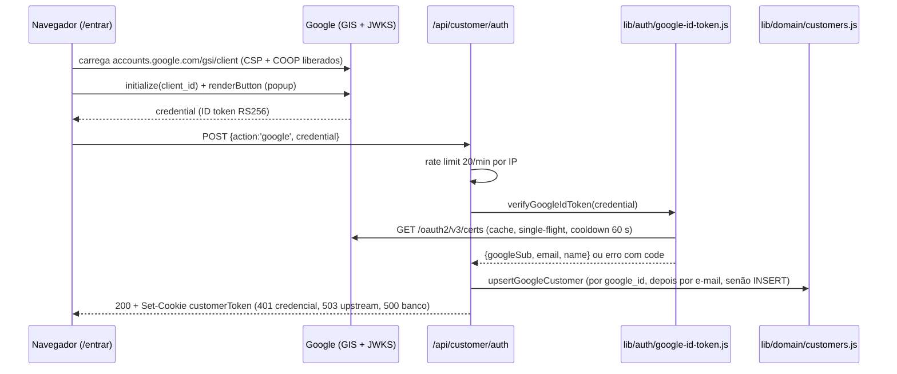

# Auditoria Semanal — Integração com o Google
## Projeto Caminhar | Registro central de auditorias e Planos de Ação

> Este documento acumula as auditorias semanais da Integração com o Google. Cada ciclo é acrescentado ao final do histórico (§10). Nenhum ciclo anterior deve ser apagado; apenas o **status** das ações pode ser atualizado quando houver evidência.
> Rotina somente de análise: **nenhuma alteração de código, configuração ou documentação existente foi feita**. A implementação depende de pedido posterior e específico.

**Convenção de classificação** (usada em todo o documento):

| Rótulo | Significado |
|---|---|
| **Problema confirmado** | Existe evidência concreta (código, diff, log) do comportamento problemático. |
| **Indício** | Há sinais de problema, mas falta confirmação da exploração ou do impacto. |
| **Hipótese** | Possível causa ou risco a investigar; não é erro confirmado. |
| **Melhoria recomendada** | Aprimoramento sem erro necessariamente existente. |
| **Processo validado** | Há evidência suficiente de funcionamento adequado (indicada a natureza da evidência). |

---

# Ciclo 1 — 19/11/2026

## 1. Identificação da auditoria

- **Data e horário da execução:** 19/11/2026, 16:42 (America/Sao_Paulo, BRT).
- **Período analisado:** de **12/11/2026 16:42** até **19/11/2026 16:42** (7 dias móveis, 168 h).
- **Executor:** Antigravity (rotina semanal automática).
- **Objetivo e escopo:** reconstruir, validar e documentar o fluxo de **Sign in with Google** (Google Identity Services, GIS) do visitante do Site Público e seus componentes indiretos (CSP, COOP, variáveis de ambiente, conta do visitante, testes, documentação), produzindo um Plano de Ação. O Google **não** é usado no `/admin` (login de operador é isolado: `docs/ARQUITETURA_SITE_PRIVADO.md`, linha 14).
- **Fontes consultadas:**
  - Documentos-guia (somente leitura): `AGENTS.md`, `docs/ARQUITETURA_SITE_PUBLICO.md` (§3.5, §5.1, item 21 do §7), `docs/ARQUITETURA_SITE_PRIVADO.md` (§1, §4.8, §9).
  - Git: `git log --since` (31 commits na janela) e diffs dos commits `80478dd`, `75fb1cb`, `fad08f6` (e `819bcb1` para `customers.js`); `git status` (árvore limpa); `git check-ignore .env`.
  - Código: `lib/auth/google-id-token.js`, `pages/api/customer/auth.js`, `lib/domain/customers.js`, `lib/auth/customer-auth.js`, `pages/entrar.js`, `pages/_document.js`, `next.config.js`, `hooks/usePerformanceMetrics.js`, `scripts/check-env.js`, `scripts/validate-schema.js`, `.env.example`, `utils/resolve-next.js`.
  - Testes (lidos, não executados): `tests/unit/lib/auth/google-id-token.test.js`, `tests/integration/api/customer/auth.test.js`, `tests/integration/domain/customers.db.test.js`, `tests/unit/pages/entrar.test.js`, `tests/unit/pages/document-csp.test.js`, `tests/unit/next.config.test.js`.
  - Documentação técnica: `docs/adr/0037`, `docs/adr/0042`, `docs/adr/README.md`, `CHANGELOG.md`, `docs/PROJECT_lib.md`, `docs/PROJECT_raiz.md`, `docs/PROJECT_hooks.md`, `docs/melhoria_mercadopago.md` (formato de referência), `docs/melhoria_agente.md`.
  - CI: `.github/workflows/*` (nenhum workflow alterado na janela; nenhuma referência a Google).
- **Limitações encontradas** (nada foi presumido a partir delas):
  1. **ai-memory (MCP) negado** nesta execução (`memory_read_page`, `memory_query`): o conteúdo das sessões e do handoff não pôde ser lido. Do que o hook de início injetou, só consta: handoff de `antigravity-cli` ("Turn checkpoint; 88 observations recorded", sem detalhes) e uma sessão recente cujo título diz que o dono preencheu `NEXT_PUBLIC_GOOGLE_CLIENT_ID` e `GOOGLE_CLIENT_ID` no `.env`. Não houve tentativa de contornar a negativa.
  2. **Histórico do OpenCode indisponível:** não existe `~/.local/share/opencode`; só há configuração em `~/.config/opencode` (sem sessões). **Histórico do Antigravity:** só o transcript desta própria execução é visível; as conversas anteriores não estão acessíveis. Logo, **não é possível atribuir cada commit a OpenCode ou Antigravity** (todos têm o mesmo autor Git) nem confirmar quais documentos cada agente consultou.
  3. **Testes não executados** (restrição de não alterar estado). `logs/tests-output.log` e `logs/coverage-output.log` são de 18/11/2026 10:46–10:48, **anteriores** aos commits do Google; não servem de evidência. O `CHANGELOG.md` afirma "234/234 suítes, 1965 testes" (entrada de `80478dd`), mas isso é **declaração**, anterior ao commit de refinamento `fad08f6` (que reescreveu a verificação do token).
  4. **GitHub Actions:** sem acesso à rede; não foi possível listar execuções. Apenas se constatou que os workflows não mudaram.
  5. **`.env` não lido** (regra do `AGENTS.md` §6): não foi verificado se `GOOGLE_CLIENT_ID` e `NEXT_PUBLIC_GOOGLE_CLIENT_ID` estão preenchidos nem se coincidem em produção. A "validação ao vivo em `localhost:3000`" citada no CHANGELOG/ADR-0042/Arquitetura Pública **não pôde ser reproduzida**.
  6. **Console do Google Cloud** (origens JavaScript autorizadas, tela de consentimento, status de publicação) é externo e não foi consultado.

## 2. Resumo do fluxo identificado

### 2.1 Funcionamento geral

O visitante entra por `/entrar` e clica no botão oficial do GIS. O navegador recebe um **ID token (JWT `RS256`)** do Google e o envia a `POST /api/customer/auth` (`action: 'google'`, `credential`). O servidor valida o token **localmente** (assinatura via JWKS do Google + claims), cria ou vincula o registro em `customers` e emite o cookie `httpOnly` `customerToken` (`scope: 'customer'`, 24 h, `SameSite=Lax`, `Secure` em produção).

### 2.2 Rotinas, etapas e processos executados na janela

Cronologia (commits Git; ver limitação 2 sobre autoria por agente):

| Data/hora | Commit | O que mudou (Google) |
|---|---|---|
| 19/11 11:41 | `80478dd` "Ajustes Gerais Google" | Ativação do GIS em `pages/entrar.js` (script dinâmico com deduplicação, `ux_mode: 'popup'`, `renderButton`, retry); CSP em `pages/_document.js` (`script-src`, `style-src`, `frame-src`); `Cross-Origin-Opener-Policy: same-origin-allow-popups` em `/entrar` (`next.config.js`); `accounts.google.com` em `THIRD_PARTY_DOMAINS` (`usePerformanceMetrics.js`); `/api/customer/auth` endurecido (validação via `tokeninfo` com timeout 8 s); testes novos/ampliados; docs e CHANGELOG. |
| 19/11 12:13 | `75fb1cb` "Standards" | Largura do botão (`resolveGoogleButtonWidth`), visibilidade do host do botão, ícone e CSS; testes de `entrar` e `minha-conta`. |
| 19/11 15:37 | `fad08f6` "Refinamento" | **ADR-0042:** `tokeninfo` substituído por verificação local JWKS em `lib/auth/google-id-token.js` (264 linhas) + 721 linhas de teste; `/api/customer/auth` separa 401/503/500; docs (`PROJECT_lib`, `PROJECT_raiz`, Arquitetura Pública, README de ADR). |

Antes da janela (contexto, não é atividade da semana): tabela `customers` com `google_id` (migração 023, 08/11, ADR-0037). Dentro da janela, `819bcb1` (13/11) apenas alinhou colunas SQL de `customers.js` ao schema real (ADR-0039).

Rotinas recorrentes: **nenhuma rotina agendada própria do Google** (o JWKS é renovado de forma *lazy* conforme `Cache-Control: max-age`, sem `setInterval`). A reconciliação do Mercado Pago não envolve o Google.

### 2.3 Arquivos e componentes envolvidos

| Camada | Arquivo | Papel |
|---|---|---|
| UI | `pages/entrar.js` | Carrega GIS, renderiza o botão, envia o `credential`, redireciona via `resolveNext`. |
| Segurança de navegador | `pages/_document.js` (CSP em `<meta>`), `next.config.js` (COOP em `/entrar`) | Liberam `accounts.google.com/gsi/*` e a comunicação do popup. |
| API | `pages/api/customer/auth.js` | Orquestra: rate limit, validação Zod, tradução de erros, cookie. |
| Verificação | `lib/auth/google-id-token.js` | JWKS, cache, `RS256`, `aud`/`iss`/`exp`/`email_verified`. Usa `jsonwebtoken` ^9.0.3 + `node:crypto`. |
| Domínio | `lib/domain/customers.js` (`upsertGoogleCustomer`) | Vínculo por `google_id` → e-mail → criação. |
| Sessão | `lib/auth/customer-auth.js` | JWT `scope: 'customer'`, cookie `customerToken`. |
| Dados | `scripts/migrations/023-...js`, `scripts/validate-schema.js` | Coluna `customers.google_id VARCHAR(255) UNIQUE`. |
| Configuração | `.env.example`, `scripts/check-env.js` | Variáveis opcionais `GOOGLE_CLIENT_ID` e `NEXT_PUBLIC_GOOGLE_CLIENT_ID`. |
| Observabilidade | `hooks/usePerformanceMetrics.js` | Domínio de terceiros e orçamento de 5 s para `/api/customer/auth`. |
| Testes | ver §1 | Unidade, integração (API e DB real) e CSP/config. Sem E2E do fluxo Google. |
| Documentação | ADR-0037/0042, `PROJECT_lib.md`, `ARQUITETURA_SITE_PUBLICO.md` | Registro de decisões e estrutura. |

### 2.4 Relação com os documentos de arquitetura

- `AGENTS.md` (§0.1/§0.2) manda ler `ARQUITETURA_SITE_PUBLICO.md` para tudo que toque site público, navegação, APIs e conta do visitante (§3.5/§5.1); o Google fica **inteiramente na área pública**. O documento privado só é acionado por mudanças que cruzem componentes compartilhados; aqui o único ponto de contato é a regra de que `customers` é isolada de `users` (`ARQUITETURA_SITE_PRIVADO.md` linha 14), **respeitada** no código (cookie, tabela e `scope` próprios).
- Mudança estrutural exige atualização do documento e da data (§0.2.5): `ARQUITETURA_SITE_PUBLICO.md` foi atualizado em `80478dd` e `fad08f6` (cabeçalho "Última atualização: 2026-11-19"). ADR-0042 criado e indexado (§3 do `AGENTS.md`).

## 3. Diagnóstico

### 3.1 Processos validados

> Natureza da evidência: **revisão estática do código + existência de testes** + consistência documental. A execução dos testes **não** foi reproduzida nesta auditoria.

| # | Processo | Evidência |
|---|---|---|
| V1 | Verificação do ID token fixa `algorithms: ['RS256']`, rejeita `alg=none`/`HS256`, exige `kid` string, valida `iss`, `aud` (escalar ou array com `azp`), `exp`, `email_verified`, `sub`, `email` e **falha fechada** sem Client ID. | `google-id-token.js` L156–252; testes L316–400, L621–721. |
| V2 | Cache JWKS com `max-age` limitado a [5 min, 24 h], single-flight e cooldown de 60 s contra spam de `kid` desconhecido. | `google-id-token.js` L76–154; testes L135–260, L518–620. |
| V3 | Classificação de erro: credencial inválida → 401; upstream (timeout, rede, 5xx, JWKS inválido) → 503; falha de banco após token válido → 500. | `auth.js` L178–202; teste de integração L584–633. |
| V4 | Atalho `googleSub+email` sem credencial **bloqueado em `NODE_ENV=production`** (ver, porém, MG-01). | `auth.js` L61; teste L413. |
| V5 | Isolamento visitante × operador: tabela `customers`, cookie `customerToken`, `scope: 'customer'`, `httpOnly`, `SameSite=Lax`, `Secure` em produção. | `customer-auth.js`; ADR-0037. |
| V6 | Redirecionamento pós-login via `resolveNext` (utilitário dedicado, validado no T6 anterior). | `entrar.js` L107. |
| V7 | CSP e COOP liberam somente origens do GIS (`gsi/client`, `gsi/style`, `gsi/`) e o COOP é restrito a `/entrar`. | `_document.js` L60–66; `next.config.js` L181–186; `document-csp.test.js`, `next.config.test.js`. |
| V8 | `.env` ignorado pelo Git; só `.env.example` versionado. Client ID não é segredo; **não há `client_secret`** no fluxo (corrigido em ADR-0037 por `80478dd`). | `git check-ignore .env`; `git ls-files`. |
| V9 | Mensagens de erro ao cliente são genéricas (sem vazar `err.message`/códigos internos); o log usa só o `code`. | `auth.js` L182–196. |
| V10 | Colunas SQL de `upsertGoogleCustomer` cobertas por teste com PostgreSQL real (`customers.db.test.js`, L147–182). | Arquivo lido. |
| V11 | Rate limit de 20 req/min por IP em ações de autenticação. | `auth.js` L115–122. |
| V12 | Processo documental do `AGENTS.md`: ADR criado, índice atualizado, Arquitetura Pública e `PROJECT_lib.md` atualizados no mesmo commit da mudança. | `git show fad08f6 --stat`. |

### 3.2 Problemas confirmados, indícios e hipóteses

**P1 — Atalho de desenvolvimento aceita login Google sem credencial fora de `production`** — *Problema confirmado (código); impacto depende do ambiente*
- Evidência: `pages/api/customer/auth.js` L61–67: com `googleSub` + `email` no corpo e `NODE_ENV !== 'production'`, o servidor aceita os valores sem nenhuma verificação e `upsertGoogleCustomer` **vincula pelo e-mail a uma conta existente**, emitindo cookie de sessão. Quem controlar o corpo da requisição assume qualquer conta de visitante naquele ambiente.
- Impacto: nulo em produção real (bloqueado e testado, V4). Real em qualquer instância com `NODE_ENV` diferente de `production` e alcançável pela rede (staging, preview, `npm run dev` exposto).
- Indício correlato (não confirmado): o histórico mostra uso de túnel público para o webhook do Mercado Pago (`6b69224`, `dbcbbc0`, 16–17/11, "validacao real de webhook via cloudflared"). Se o servidor de desenvolvimento esteve atrás desse túnel, o atalho ficou alcançável. **Falta evidência** de qual processo (`dev` ou `start`) estava exposto.

**P2 — Vínculo automático por e-mail sem verificação de posse na conta local (risco de pré-sequestro de conta)** — *Indício (as pré-condições estão confirmadas no código; a exploração não foi testada)*
- Evidência: `registerCustomer` (`customers.js` L30–52) cria conta com e-mail e senha **sem confirmar o e-mail**. `upsertGoogleCustomer` (L93–103) vincula `google_id` a **qualquer** registro com o mesmo e-mail, **mantendo `password_hash`**.
- Cenário lógico: um terceiro cadastra com senha o e-mail da vítima; a vítima entra depois com Google e é vinculada à conta que o terceiro ainda pode acessar com a senha original (vê pedidos, endereço, telefone dessa conta).
- Agravante pontual: o `UPDATE` não exige `google_id IS NULL`; um `sub` diferente com o mesmo e-mail **sobrescreve** o `google_id` existente.

**P3 — Falhas de configuração aparecem como "credencial inválida" (401) e com nível `warn`** — *Problema confirmado (comportamento) / Melhoria de monitoramento*
- Evidência: `GOOGLE_NOT_CONFIGURED`, `GOOGLE_AUDIENCE_MISMATCH` (causa mais provável de erro de Client ID trocado entre ambientes) e `INVALID_GOOGLE_ISSUER` retornam 401 e o log é `logger.warn` com o `code` (`auth.js` L182–196). Não há contador nem alerta; o usuário final vê "Verifique a configuração", texto sem ação possível para ele.
- Contexto: a sessão recente sobre preenchimento do `.env` (limitação 1) é compatível com esse tipo de erro, mas **não há evidência** de falha real ocorrida.

**P4 — Estado "não configurado" exibe botão morto e revela o nome de variável interna no site público** — *Problema confirmado (código)*
- Evidência: `pages/entrar.js` L238–242 e L420–446: sem `NEXT_PUBLIC_GOOGLE_CLIENT_ID`, o visitante vê um botão "Sign in with Google" que, ao clicar, mostra "requer a configuração de NEXT_PUBLIC_GOOGLE_CLIENT_ID no ambiente".
- Inconsistência documental: `.env.example` L133–134 afirma que, sem a variável, a opção é **desativada** na interface pública; o código apenas esconde o botão oficial e mostra um substituto.
- Observação: `NEXT_PUBLIC_*` é embutida no build; alterar o `.env` exige reiniciar/rebuild (não está documentado como passo operacional).

**P5 — Falha do JWKS derruba logins mesmo com chaves em cache apenas vencidas** — *Melhoria recomendada*
- Evidência: com cache expirado e `fetch` falhando, `getJwks` lança `GOOGLE_UPSTREAM_UNAVAILABLE` (L100–134) e descarta a oportunidade de usar as chaves antigas (que seguem válidas até serem rotacionadas).

**P6 — Lacunas de documentação operacional e inconsistências** — *Problema confirmado (documentação)*
- Não há, em nenhum `.md`/ADR, o passo a passo do Google Cloud Console (tipo de credencial, **origens JavaScript autorizadas** para `localhost` e domínio de produção, tela de consentimento e seu status de publicação). `grep` por esses termos retornou vazio.
- `CHANGELOG.md` L115–118 (entrada de 19/11) descreve a validação por `tokeninfo` com timeout 8 s e mapeamento por `TimeoutError`/`AbortError`, **superada no mesmo dia** pela entrada L43–46 (ADR-0042); lida isoladamente induz a erro.
- `.env.example` L128–129 cita login Google "na finalização de compras em `/checkout/[id]`"; `checkout/[id].js` não tem GIS (o visitante é enviado a `/entrar`).
- A decisão de **CSP/COOP/ativação do GIS** (`80478dd`) não tem ADR próprio; apenas o ADR-0042 (JWKS) e uma correção de duas linhas no ADR-0037. O `AGENTS.md` §3 pede ADR para decisão de arquitetura relevante; mudança de cabeçalhos de segurança é candidata.

**P7 — Rastreabilidade do trabalho dos agentes** — *Indício / Melhoria recomendada*
- Mensagens de commit genéricas ("ATT - …") e arquivos gerados (`estrutura*.html/txt`, `tree.txt`) em quase todo commit com milhares de linhas de ruído dificultam auditar autoria e escopo (ex.: `80478dd` mistura Google, CSP, métricas e documentação). Sem logs de sessão não dá para atribuir a OpenCode ou Antigravity.

**Hipóteses (não confirmadas)**
- **H1 — Reuso de ID token roubado:** o fluxo não usa `nonce`; um token válido (~1 h) capturado poderia ser reenviado. Exigiria comprometer o navegador ou o transporte; probabilidade e utilidade a avaliar.
- **H2 — Cache JWKS por processo em múltiplas instâncias:** um cold start a cada instância gera 1 requisição extra; aceito no ADR-0042. Sem evidência de problema.
- **H3 — Acoplamento a mensagens do `jsonwebtoken`:** `message.includes('jwt audience invalid')` etc. (L211–217) depende do texto da biblioteca; uma atualização de versão menor pode alterar o mapeamento (os testes de integração o detectariam, se executados).
- **H4 — Produção:** domínio, origens autorizadas, status da tela de consentimento ("Teste" limita a usuários cadastrados) e coincidência dos dois Client IDs **não verificados**.

### 3.3 Erros e falhas ocorridos na janela

- **Falhas observadas em execução:** **nenhuma evidência disponível** (sem logs de execução do Google na janela; `logs/` é anterior). Não se afirma que houve ou não falhas em runtime.
- **Falhas de design corrigidas na própria janela** (comprovadas pelos diffs): (a) dependência síncrona de `oauth2.googleapis.com/tokeninfo` a cada login; (b) falha de rede/5xx do Google resultava em 401 em vez de 503; (c) `prompt()` sem script carregado (substituído pelo botão oficial); (d) CSP/COOP ausentes para o GIS; (e) `GOOGLE_CLIENT_SECRET` citado no ADR-0037 sem uso.
- **Falhas recorrentes:** não há evidência. Há **retrabalho em um dia**: o mesmo trecho de validação foi reescrito três vezes em 19/11 (11:41 → 12:13 → 15:37); coerente com refinamento iterativo, sem indício de defeito residual.

### 3.4 Correções realizadas e resultado

| Correção | Arquivos | Problema | Confirmada por teste posterior? | Regressão possível |
|---|---|---|---|---|
| Verificação local JWKS (ADR-0042) | `google-id-token.js`, `auth.js` | Round-trip por login; 401 vs 503 | **Testes existem** (721 + ~320 linhas); **execução não verificada** nesta auditoria. CHANGELOG declara "validação ao vivo". | Mapeamento por texto do `jsonwebtoken` (H3); mudança do cooldown/TTL. |
| GIS + CSP + COOP | `entrar.js`, `_document.js`, `next.config.js` | Botão inexistente/bloqueado | Testes unitários de CSP/config/página existem; ao vivo só declarado. | Qualquer ajuste de CSP/COOP em `/entrar`; COOP também afeta outras janelas abertas pela página. |
| Largura/visibilidade do botão | `entrar.js`, `CustomerPages.module.css` | Layout | Testes de `entrar` existem. | Baixa. |

### 3.5 Duplicidades e inconsistências

- `google-id-token.js` valida `aud` e `exp` **duas vezes** (opções do `jwt.verify` e verificações manuais L221–233). É defesa em profundidade, mas duplica a lógica e exige manter dois conjuntos de testes. Melhoria opcional (MG-09).
- Seleção do Client ID duplicada entre `entrar.js` (só `NEXT_PUBLIC_`) e o servidor (`GOOGLE_CLIENT_ID` com fallback). A divergência gera apenas `warn`; o navegador pode usar um ID e o servidor outro, e o login falha com `GOOGLE_AUDIENCE_MISMATCH` (P3).
- Inconsistências documentais: ver P6.

### 3.6 Lacunas de testes e validações

- **Sem execução recente comprovada** dos testes do Google após `fad08f6` (limitação 3).
- Sem teste para P1 em `NODE_ENV` `development`/`test`/ausente (só há para `production`), nem para o atalho em ambientes não produtivos como comportamento documentado.
- Sem teste de P2 (pré-sequestro) nem do `UPDATE` que sobrescreve `google_id` divergente.
- Sem E2E (Cypress) do fluxo Google; `cypress/e2e/checkout.cy.js` apenas intercepta `GET /api/customer/auth`. O GIS não é automatizável diretamente; um mock do script seria necessário.
- Sem verificação automática do estado de configuração (`scripts/check-env.js` apenas avisa se as variáveis estão ausentes; não detecta divergência entre as duas).
- Gates `npm run knip` e `npm run lint:workflows` (`AGENTS.md` §7.8) não verificados para o commit final. Indício favorável: `createGoogleIdTokenVerifier` é exportado, usado no próprio arquivo e em testes, e `knip.json` tem `ignoreExportsUsedInFile: true`.

## 4. Melhorias propostas

> Todas preservam o comportamento atual do fluxo feliz (login Google válido continua funcionando). As decisões marcadas **(dono)** dependem de escolha do dono do projeto.

### MG-01 — Restringir o atalho de desenvolvimento do login Google
- **Problema:** P1.
- **Evidências:** `auth.js` L61–67; teste só para `production`.
- **Benefício:** elimina a tomada de conta em qualquer ambiente não produtivo alcançável.
- **Arquivos:** `pages/api/customer/auth.js`, `tests/integration/api/customer/auth.test.js`, `.env.example`, `docs/ARQUITETURA_SITE_PUBLICO.md` (se o comportamento for citado).
- **Impactos e dependências:** o teste existente `action=google: deve vincular...` (L195) usa o atalho; precisará da nova condição (ex.: variável explícita de teste) ou de migrar para token RS256 assinado com a chave dinâmica já usada em L222+.
- **Riscos:** quebrar o fluxo manual de desenvolvimento sem cliente Google; mitigável mantendo o atalho apenas com `NODE_ENV` em `development` ou `test` **e** variável explícita desligada por padrão **(dono)**.
- **Prioridade sugerida:** **Alta.**

### MG-02 — Impedir pré-sequestro no vínculo por e-mail
- **Problema:** P2.
- **Evidências:** `customers.js` L30–52 e L93–103.
- **Benefício:** garante que a conta vinculada pelo Google não preserve acesso por senha definida por terceiro.
- **Opções (dono):** (a) ao vincular a uma conta com `password_hash` ainda não confirmada, **anular `password_hash`** (a posse do e-mail foi provada pelo Google; o usuário pode redefinir senha depois, se existir fluxo); (b) exigir a senha atual para vincular; (c) confirmação de e-mail no cadastro convencional. A (a) é a de menor mudança. Exigir também `google_id IS NULL` no `UPDATE` e tratar o `sub` divergente como conflito.
- **Arquivos:** `lib/domain/customers.js`, `tests/integration/domain/customers.db.test.js`, `tests/unit/lib/domain/customers.test.js`, `tests/integration/api/customer/auth.test.js`.
- **Impactos e dependências:** a opção (a) pode surpreender quem se cadastrou com senha e depois entrou com Google (perde a senha). Verificar se existe "esqueci minha senha" (**NÃO DETERMINADO**: não foi buscado fluxo de redefinição nesta auditoria).
- **Riscos:** regressão no vínculo legítimo; cobrir com o teste de DB existente (L147–182).
- **Prioridade sugerida:** **Média-Alta**; subir para Alta se se confirmar a exploração (investigação em §8).

### MG-03 — Distinguir erro de configuração de credencial inválida
- **Problema:** P3.
- **Benefício:** diagnóstico rápido de Client ID errado/ausente em produção.
- **Proposta:** logar `GOOGLE_NOT_CONFIGURED` e `GOOGLE_AUDIENCE_MISMATCH` em nível de erro com contexto sem segredos (sem valores de ID); manter 401 para o cliente, ou 503 para `GOOGLE_NOT_CONFIGURED` **(dono)**; contabilizar por código se houver painel de métricas.
- **Arquivos:** `pages/api/customer/auth.js`; opcionalmente `lib/auth/google-id-token.js`; testes de integração correspondentes.
- **Impactos:** o teste que espera 401 sem Client ID (L397) mudaria se o status for alterado.
- **Riscos:** vazamento de configuração em log; manter só códigos.
- **Prioridade sugerida:** **Média.**

### MG-04 — Estado "não configurado" sem botão morto e sem expor variável
- **Problema:** P4.
- **Benefício:** UX coerente para o visitante e menos exposição de detalhes internos; alinha `.env.example` ao comportamento.
- **Proposta:** ocultar o botão (como diz `.env.example`) ou mostrar mensagem genérica sem nome de variável; opcionalmente avisar o operador via `check-env`/log, não pelo site público.
- **Arquivos:** `pages/entrar.js` (L238–242, L420–446), `tests/unit/pages/entrar.test.js`, `.env.example`.
- **Impactos:** testes de `entrar` que verificam o texto do fallback; texto de Arquitetura Pública (§5.1) se descrever o fallback.
- **Riscos:** baixo; aplicar o `MASTER.md`/regras visuais se houver alteração de layout.
- **Prioridade sugerida:** **Baixa-Média.**

### MG-05 — Usar chaves vencidas quando o JWKS estiver indisponível
- **Problema:** P5.
- **Benefício:** menos 503 em instabilidade breve do Google; mantém a política de `max-age` para o caso normal.
- **Proposta:** em falha upstream, se existir cache vencido (limite máximo razoável), reutilizá-lo e registrar `warn`; tokens com `kid` desconhecido continuam falhando.
- **Arquivos:** `lib/auth/google-id-token.js`, `tests/unit/lib/auth/google-id-token.test.js` (o teste "preserva cooldown após falha", L545, e os de 503, L407/L492, devem ser revisados).
- **Impactos:** muda a semântica do ADR-0042 (consequências); registrar no ADR.
- **Riscos:** aceitar chave revogada por mais tempo; limitar o prazo.
- **Prioridade sugerida:** **Baixa.**

### MG-06 — Runbook de configuração e implantação do Google
- **Problema:** P6 (lacuna) e H4.
- **Benefício:** reduz erros de configuração recorrentes (origens autorizadas, Client ID divergente, necessidade de rebuild, tela de consentimento).
- **Conteúdo mínimo:** tipo de credencial (ID do cliente OAuth "Aplicativo da Web"), origens JavaScript autorizadas (localhost e domínio), tela de consentimento e status, igualdade dos dois IDs, `NEXT_PUBLIC_*` exigir rebuild/restart, teste de fumaça pós-deploy.
- **Local:** ADR-0042 (seção "Operação") ou `docs/ARQUITETURA_SITE_PUBLICO.md` §5.1 **(dono decide)**; **não** criar arquivo novo sem decisão.
- **Prioridade sugerida:** **Média.**

### MG-07 — Consistência documental e registro da decisão de CSP/COOP/GIS
- **Problema:** P6.
- **Proposta:** (a) marcar a entrada de 19/11 do CHANGELOG (L115–118) como superada pelo ADR-0042, ou corrigir o trecho de `tokeninfo`; (b) corrigir a menção a `/checkout/[id]` em `.env.example`; (c) registrar a decisão de CSP/COOP/GIS em ADR (novo ou adendo ao 0037/0042) conforme `docs/adr/README.md`.
- **Arquivos:** `CHANGELOG.md`, `.env.example`, `docs/adr/` (novo ADR) e `docs/adr/README.md`.
- **Riscos:** baixo; apenas documentação.
- **Prioridade sugerida:** **Baixa.**

### MG-08 — Verificação e ampliação de testes
- **Problema:** §3.6.
- **Proposta:** (1) executar a verificação completa do estado atual (ver §7); (2) testes para MG-01/02/03/04; (3) teste de DB para `google_id` divergente; (4) considerar um E2E com GIS mockado apenas se o custo for aceitável **(dono)**.
- **Arquivos:** os testes citados em §3.6.
- **Prioridade sugerida:** **Alta** para o item (1); **Média** para os demais, acompanhando cada melhoria.

### MG-09 — Simplificar validações duplicadas e reduzir acoplamento ao texto do `jsonwebtoken` *(opcional)*
- **Problema:** §3.5 e H3.
- **Proposta:** manter uma única fonte para `aud`/`exp` (ou manter ambas e documentar que é defesa em profundidade) e mapear erros por `err.name`/tipo quando possível.
- **Riscos:** reduzir uma barreira defensiva; só fazer com os testes atuais verdes.
- **Prioridade sugerida:** **Baixa** (adiar sem prejuízo).

### MG-10 — Rastreabilidade de commits e sessões *(opcional)*
- **Problema:** P7.
- **Proposta:** commits com escopo (`feat(auth): ...`), separando artefatos gerados (`estrutura*`, `tree.txt`) do código; registrar no handoff qual agente executou cada etapa.
- **Prioridade sugerida:** **Baixa.**

## 5. Plano de execução por arquivo ou componente

(Só arquivos que precisam de alteração. Nada foi alterado nesta auditoria.)

### 5.1 `/home/gus/projetos/Caminhar/pages/api/customer/auth.js`
- **Situação atual:** atalho dev por `NODE_ENV !== 'production'` (L61–67); 401 genérico para todos os erros que não sejam upstream (L193–196), log `warn` com `code`.
- **Alteração proposta:** MG-01 (condição explícita do atalho) e MG-03 (nível e categoria de log para erros de configuração).
- **Justificativa técnica:** P1 e P3.
- **Impactos:** `tests/integration/api/customer/auth.test.js` (L195, L397, L413).
- **Dependências:** decisão do dono sobre o atalho e sobre o status HTTP de `GOOGLE_NOT_CONFIGURED`.
- **Cuidados:** não alterar a separação 401/503/500 (V3) nem as mensagens genéricas (V9); `upsertGoogleCustomer` continua fora do `try/catch` de verificação.

### 5.2 `/home/gus/projetos/Caminhar/lib/domain/customers.js`
- **Situação atual:** `upsertGoogleCustomer` vincula por e-mail mantendo `password_hash` e sobrescrevendo `google_id` (L93–103).
- **Alteração proposta:** MG-02 (decisão do dono: anular senha, exigir senha atual ou confirmar e-mail) e condição `google_id IS NULL` com tratamento de conflito.
- **Justificativa técnica:** P2.
- **Impactos:** `/api/customer/auth` (login por senha de contas já vinculadas), `minha-conta`, pedidos associados ao `customer.id` (o `id` **não** deve mudar).
- **Dependências:** verificar existência de redefinição de senha (NÃO DETERMINADO).
- **Cuidados:** SQL novo exige teste em PostgreSQL real (`npm run test:db:container`, `AGENTS.md` §7.1; ADR-0039); preservar `sanitizeCustomer` e aliases de saída.

### 5.3 `/home/gus/projetos/Caminhar/lib/auth/google-id-token.js`
- **Situação atual:** falha upstream com cache vencido derruba a verificação; validações de `aud`/`exp` duplicadas; mapeamento por texto de mensagem.
- **Alteração proposta:** MG-05 (stale-if-error limitado) e, opcionalmente, MG-09.
- **Justificativa técnica:** P5, H3 e §3.5.
- **Impactos:** `tests/unit/lib/auth/google-id-token.test.js` (L407, L492, L545), ADR-0042.
- **Dependências:** definir o prazo máximo de chave vencida.
- **Cuidados:** manter `RS256` fixo, fail-closed sem Client ID, single-flight e cooldown; não adicionar dependências (decisão do dono no ADR-0042).

### 5.4 `/home/gus/projetos/Caminhar/pages/entrar.js`
- **Situação atual:** em `unconfigured` mostra botão substituto e nome de variável (L238–242, L420–446).
- **Alteração proposta:** MG-04.
- **Justificativa técnica:** P4.
- **Impactos:** `tests/unit/pages/entrar.test.js`; `pages/styles/CustomerPages.module.css` se o layout mudar.
- **Cuidados:** manter o container do botão sempre montado (decisão para React 19 e retry, CHANGELOG); respeitar tokens do `variables.css` e acessibilidade (`role="status"`).

### 5.5 `/home/gus/projetos/Caminhar/.env.example`
- **Situação atual:** diz que o Google é "desativado" sem a variável e cita `/checkout/[id]` (L128–134).
- **Alteração proposta:** MG-04, MG-06, MG-07 — texto fiel ao código e lembrete de que `NEXT_PUBLIC_*` exige rebuild e de que os dois IDs devem coincidir.
- **Cuidados:** não incluir valores reais.

### 5.6 `/home/gus/projetos/Caminhar/CHANGELOG.md`
- **Situação atual:** duas entradas de 19/11 sobre Google com validação diferente (L43–46 vs L115–118).
- **Alteração proposta:** MG-07 (anotar a entrada superada).
- **Cuidados:** preservar o histórico; só acrescentar a nota de substituição.

### 5.7 `/home/gus/projetos/Caminhar/docs/adr/` (novo ADR + `README.md`) e, se o dono decidir, `docs/adr/0042-google-id-token-local-jwks-verification.md`
- **Situação atual:** sem ADR para CSP/COOP/GIS; sem seção operacional.
- **Alteração proposta:** MG-06 e MG-07 (usar `docs/adr/template.md`; ADR do repositório é a fonte oficial).
- **Cuidados:** respeitar o formato do projeto (`AGENTS.md` §3) e atualizar o índice.

### 5.8 Testes
- `/home/gus/projetos/Caminhar/tests/integration/api/customer/auth.test.js`: MG-01, MG-03.
- `/home/gus/projetos/Caminhar/tests/integration/domain/customers.db.test.js`: MG-02 e `google_id` divergente.
- `/home/gus/projetos/Caminhar/tests/unit/lib/domain/customers.test.js`: MG-02 (mock de `db`; **não** prova o SQL, ADR-0039).
- `/home/gus/projetos/Caminhar/tests/unit/lib/auth/google-id-token.test.js`: MG-05/MG-09.
- `/home/gus/projetos/Caminhar/tests/unit/pages/entrar.test.js`: MG-04.
- **Cuidados:** não reduzir a cobertura existente; não usar `as`/mocks que escondam o SQL real.

## 6. Sequência recomendada de implementação

1. **Linha de base (MG-08.1):** executar os testes do Google e os gates (ver §7) **sem alterar código**; se algo falhar, tratar antes de seguir. *Critério:* resultados registrados na próxima auditoria.
2. **Esclarecer P1 e P2** (investigações de §8, sem código): qual servidor esteve exposto pelo túnel; existência de redefinição de senha; dados reais com e-mail duplicado.
3. **MG-01** (Alta): depende do passo 1; teste primeiro (TDD), depois a condição. *Critério:* sem credencial válida não há sessão em nenhum `NODE_ENV` sem a variável explícita.
4. **MG-02** (Média-Alta): depende da decisão do dono e do passo 2; testes em PostgreSQL real. *Critério:* o vínculo legítimo continua funcionando e o acesso por senha de terceiro deixa de existir após o vínculo.
5. **MG-03 e MG-04** (Média/Baixa-Média): independentes entre si; ajustam `auth.js`, `entrar.js` e `.env.example`. *Critério:* testes atualizados verdes e mensagem sem nome de variável.
6. **MG-06 e MG-07** (Média/Baixa): documentação; podem ocorrer em paralelo aos passos 3–5. *Critério:* runbook publicado e entrada de CHANGELOG anotada; ADR indexado.
7. **MG-05, MG-09, MG-10** (Baixa): somente se o dono julgar valer a manutenção.
8. **Fechamento (`AGENTS.md` §7):** testes, `npm run knip`, `npm run lint:workflows`, revisão do checklist, atualização de documento/data se a mudança for estrutural, registro em ADR.

## 7. Critérios de validação

| Item | Testes necessários | Resultado esperado | Critério objetivo de conclusão |
|---|---|---|---|
| Linha de base (MG-08.1) | `npx jest tests/unit/lib/auth tests/integration/api/customer tests/unit/pages/entrar.test.js tests/unit/pages/document-csp.test.js tests/unit/next.config.test.js tests/unit/lib/domain/customers.test.js`; `npm run test:db:container` (customers); `npm run knip`; `npm run lint:workflows` | Todos verdes | Saída arquivada e citada na próxima auditoria (não executada neste ciclo) |
| MG-01 | `NODE_ENV=production`, `development`, `test` e sem variável explícita enviando `googleSub+email` sem `credential` | 401 sem Set-Cookie nos casos bloqueados; fluxo com `credential` RS256 válido segue 200 | Teste novo cobrindo os 3 `NODE_ENV` e `auth.test.js` inteiro verde |
| MG-02 | DB real: conta com senha + login Google do mesmo e-mail; `sub` divergente; conta nova | Vínculo conserva `id` e pedidos; senha anterior não autentica mais (opção a) ou política escolhida cumprida; `sub` divergente → conflito | `customers.db.test.js` com os 3 cenários verdes |
| MG-03 | Ausência de Client ID, `aud` divergente, `iss` inválido | Log de erro por código, sem valores; status conforme decisão | Teste verifica o log e o status; sem vazamento do ID |
| MG-04 | Render de `/entrar` sem `NEXT_PUBLIC_GOOGLE_CLIENT_ID`; com ID | Sem texto de variável interna; botão oficial com ID | `entrar.test.js` atualizado verde; revisão visual conforme `MASTER.md` |
| MG-05 | JWKS vencido + `fetch` falhando; `kid` desconhecido + falha | Login com chave vencida (dentro do limite) → 200 com `warn`; `kid` desconhecido → 503/401 conforme regra | Testes unitários novos e os de cooldown mantidos verdes |
| MG-06/07 | Revisão documental | Runbook com origens, consentimento, rebuild; CHANGELOG sem contradição; ADR indexado | Revisão do dono; `docs/adr/README.md` atualizado |
| Fumaça pós-implantação (manual) | `/entrar` → Google → `/minha-conta` → reload → logout, em `localhost` e no domínio de produção | Sessão criada e encerrada; sem erro de CSP/COOP/`origin_mismatch` | Registro do resultado no ciclo seguinte |

## 8. Pendências e pontos de atenção

**Investigação adicional**
1. Confirmar se o servidor exposto pelo túnel `cloudflared` (16–17/11) rodava com `NODE_ENV` diferente de `production` (P1).
2. Verificar existência de fluxo de redefinição de senha do visitante e se há `customers` com `password_hash` e `google_id` no mesmo e-mail (impacto de MG-02). **Consulta ao banco não executada (restrição).**
3. Confirmar em execução real o estado final de `fad08f6`: testes e gates do §7 (limitação 3).
4. Avaliar H1 (`nonce`) e decidir se compensa.

**Informação insuficiente / sem evidência**
- Execuções de GitHub Actions da janela; logs de execução do Google no servidor; histórico completo do OpenCode e do Antigravity; conteúdo do ai-memory (handoff e sessões); valores do `.env` (não lidos por regra); ocorrência real de falhas de login Google.
- Atribuição por agente (OpenCode × Antigravity) e quais documentos de arquitetura cada um consultou.

**Dependências externas**
- Google Cloud Console (origens, consentimento, publicação); disponibilidade de `www.googleapis.com/oauth2/v3/certs`; navegadores/bloqueadores de script e política COOP.

**Riscos a avaliar**
- Mudar o comportamento do atalho dev pode afetar rotinas manuais de teste (MG-01).
- Mudar o vínculo por e-mail afeta usuários reais já vinculados (MG-02): migração/retrocompatibilidade a definir.
- Instâncias múltiplas: cache JWKS por processo (H2).

## 9. Conclusão

**Avaliação geral:** a Integração com o Google (login do visitante via GIS) está **bem estruturada e documentada**, com decisão registrada (ADR-0042), verificação criptográfica local, classificação 401/503/500 e isolamento correto entre visitante e operador. O que existe em testes é extenso. O principal limite desta auditoria é a **ausência de evidência de execução** (testes, logs e ambiente real não verificados) e de histórico dos agentes.

- **Correções necessárias:** MG-01 (atalho dev) e execução da linha de base de testes (MG-08.1). MG-02 deve ser corrigida assim que o dono escolher a política (risco de pré-sequestro, hoje um indício).
- **Melhorias recomendadas:** MG-03, MG-04, MG-06 (runbook), MG-07 (consistência documental); opcionais: MG-05, MG-09, MG-10.
- **Investigações pendentes:** exposição do servidor por túnel, redefinição de senha e dados reais duplicados, estado do Console do Google em produção, H1.
- **Processos corretos a preservar:** `RS256` fixo com fail-closed; cache JWKS com single-flight e cooldown; separação 401/503/500 com mensagens genéricas; atalho bloqueado em produção; isolamento `customers` × `users` e cookie dedicado; CSP e COOP restritos às origens do GIS e à rota `/entrar`; zero novas dependências; processo documental (ADR + Arquitetura Pública + `PROJECT_lib.md` no mesmo commit); `.env` fora do Git.

## 10. Histórico de ciclos

| Ciclo | Data | Período | Status | Novas ações |
|---|---|---|---|---|
| 1 | 19/11/2026 16:42 BRT | 12/11/2026 16:42 → 19/11/2026 16:42 | Concluído (somente análise) | MG-01 a MG-10 (todas **Abertas**) |

**Status das ações (atualizar apenas com evidência):**

| ID | Prioridade | Status |
|---|---|---|
| MG-01 | Alta | Aberta |
| MG-02 | Média-Alta | Aberta (aguarda decisão do dono) |
| MG-03 | Média | Aberta |
| MG-04 | Baixa-Média | Aberta |
| MG-05 | Baixa | Aberta |
| MG-06 | Média | Aberta |
| MG-07 | Baixa | Aberta |
| MG-08 | Alta (item 1) / Média | Aberta |
| MG-09 | Baixa | Aberta (opcional) |
| MG-10 | Baixa | Aberta (opcional) |

> Este é o primeiro ciclo; não havia auditoria anterior do Google nem arquivo prévio. Nos próximos ciclos: ler este documento, verificar o status acima com evidências (commits/testes), e acrescentar `# Ciclo N` sem duplicar descobertas.
