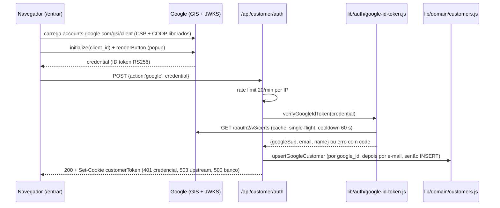

# Auditoria Semanal — Integração com o Google
## Projeto Caminhar | Registro central de auditorias e Planos de Ação

> Este documento acumula as auditorias semanais da Integração com o Google. Cada ciclo é acrescentado ao final do histórico (§10). Nenhum ciclo anterior deve ser apagado; apenas o **status** das ações pode ser atualizado quando houver evidência.
> Rotina somente de análise: **nenhuma alteração de código, configuração ou documentação existente foi feita**. A implementação depende de pedido posterior e específico.

**Convenção de classificação** (usada em todo o documento):

| Rótulo | Significado |
|---|---|
| **Problema confirmado** | Existe evidência concreta (código, diff, log) do comportamento problemático. |
| **Indício** | Há sinais de problema, mas falta confirmação da exploração ou do impacto. |
| **Hipótese** | Possível causa ou risco a investigar; não é erro confirmado. |
| **Melhoria recomendada** | Aprimoramento sem erro necessariamente existente. |
| **Processo validado** | Há evidência suficiente de funcionamento adequado (indicada a natureza da evidência). |

---

# Ciclo 1 — 19/11/2026

## 1. Identificação da auditoria

- **Data e horário da execução:** 19/11/2026, 16:42 (America/Sao_Paulo, BRT).
- **Período analisado:** de **12/11/2026 16:42** até **19/11/2026 16:42** (7 dias móveis, 168 h).
- **Executor:** Antigravity (rotina semanal automática).
- **Objetivo e escopo:** reconstruir, validar e documentar o fluxo de **Sign in with Google** (Google Identity Services, GIS) do visitante do Site Público e seus componentes indiretos (CSP, COOP, variáveis de ambiente, conta do visitante, testes, documentação), produzindo um Plano de Ação. O Google **não** é usado no `/admin` (login de operador é isolado: `docs/ARQUITETURA_SITE_PRIVADO.md`, linha 14).
- **Fontes consultadas:**
  - Documentos-guia (somente leitura): `AGENTS.md`, `docs/ARQUITETURA_SITE_PUBLICO.md` (§3.5, §5.1, item 21 do §7), `docs/ARQUITETURA_SITE_PRIVADO.md` (§1, §4.8, §9).
  - Git: `git log --since` (31 commits na janela) e diffs dos commits `80478dd`, `75fb1cb`, `fad08f6` (e `819bcb1` para `customers.js`); `git status` (árvore limpa); `git check-ignore .env`.
  - Código: `lib/auth/google-id-token.js`, `pages/api/customer/auth.js`, `lib/domain/customers.js`, `lib/auth/customer-auth.js`, `pages/entrar.js`, `pages/_document.js`, `next.config.js`, `hooks/usePerformanceMetrics.js`, `scripts/check-env.js`, `scripts/validate-schema.js`, `.env.example`, `utils/resolve-next.js`.
  - Testes (lidos, não executados): `tests/unit/lib/auth/google-id-token.test.js`, `tests/integration/api/customer/auth.test.js`, `tests/integration/domain/customers.db.test.js`, `tests/unit/pages/entrar.test.js`, `tests/unit/pages/document-csp.test.js`, `tests/unit/next.config.test.js`.
  - Documentação técnica: `docs/adr/0037`, `docs/adr/0042`, `docs/adr/README.md`, `CHANGELOG.md`, `docs/PROJECT_lib.md`, `docs/PROJECT_raiz.md`, `docs/PROJECT_hooks.md`, `docs/melhoria_mercadopago.md` (formato de referência), `docs/melhoria_agente.md`.
  - CI: `.github/workflows/*` (nenhum workflow alterado na janela; nenhuma referência a Google).
- **Limitações encontradas** (nada foi presumido a partir delas):
  1. **ai-memory (MCP) negado** nesta execução (`memory_read_page`, `memory_query`): o conteúdo das sessões e do handoff não pôde ser lido. Do que o hook de início injetou, só consta: handoff de `antigravity-cli` ("Turn checkpoint; 88 observations recorded", sem detalhes) e uma sessão recente cujo título diz que o dono preencheu `NEXT_PUBLIC_GOOGLE_CLIENT_ID` e `GOOGLE_CLIENT_ID` no `.env`. Não houve tentativa de contornar a negativa.
  2. **Histórico do OpenCode indisponível:** não existe `~/.local/share/opencode`; só há configuração em `~/.config/opencode` (sem sessões). **Histórico do Antigravity:** só o transcript desta própria execução é visível; as conversas anteriores não estão acessíveis. Logo, **não é possível atribuir cada commit a OpenCode ou Antigravity** (todos têm o mesmo autor Git) nem confirmar quais documentos cada agente consultou.
  3. **Testes não executados** (restrição de não alterar estado). `logs/tests-output.log` e `logs/coverage-output.log` são de 18/11/2026 10:46–10:48, **anteriores** aos commits do Google; não servem de evidência. O `CHANGELOG.md` afirma "234/234 suítes, 1965 testes" (entrada de `80478dd`), mas isso é **declaração**, anterior ao commit de refinamento `fad08f6` (que reescreveu a verificação do token).
  4. **GitHub Actions:** sem acesso à rede; não foi possível listar execuções. Apenas se constatou que os workflows não mudaram.
  5. **`.env` não lido** (regra do `AGENTS.md` §6): não foi verificado se `GOOGLE_CLIENT_ID` e `NEXT_PUBLIC_GOOGLE_CLIENT_ID` estão preenchidos nem se coincidem em produção. A "validação ao vivo em `localhost:3000`" citada no CHANGELOG/ADR-0042/Arquitetura Pública **não pôde ser reproduzida**.
  6. **Console do Google Cloud** (origens JavaScript autorizadas, tela de consentimento, status de publicação) é externo e não foi consultado.

## 2. Resumo do fluxo identificado

### 2.1 Funcionamento geral

O visitante entra por `/entrar` e clica no botão oficial do GIS. O navegador recebe um **ID token (JWT `RS256`)** do Google e o envia a `POST /api/customer/auth` (`action: 'google'`, `credential`). O servidor valida o token **localmente** (assinatura via JWKS do Google + claims), cria ou vincula o registro em `customers` e emite o cookie `httpOnly` `customerToken` (`scope: 'customer'`, 24 h, `SameSite=Lax`, `Secure` em produção).

### 2.2 Rotinas, etapas e processos executados na janela

Cronologia (commits Git; ver limitação 2 sobre autoria por agente):

| Data/hora | Commit | O que mudou (Google) |
|---|---|---|
| 19/11 11:41 | `80478dd` "Ajustes Gerais Google" | Ativação do GIS em `pages/entrar.js` (script dinâmico com deduplicação, `ux_mode: 'popup'`, `renderButton`, retry); CSP em `pages/_document.js` (`script-src`, `style-src`, `frame-src`); `Cross-Origin-Opener-Policy: same-origin-allow-popups` em `/entrar` (`next.config.js`); `accounts.google.com` em `THIRD_PARTY_DOMAINS` (`usePerformanceMetrics.js`); `/api/customer/auth` endurecido (validação via `tokeninfo` com timeout 8 s); testes novos/ampliados; docs e CHANGELOG. |
| 19/11 12:13 | `75fb1cb` "Standards" | Largura do botão (`resolveGoogleButtonWidth`), visibilidade do host do botão, ícone e CSS; testes de `entrar` e `minha-conta`. |
| 19/11 15:37 | `fad08f6` "Refinamento" | **ADR-0042:** `tokeninfo` substituído por verificação local JWKS em `lib/auth/google-id-token.js` (264 linhas) + 721 linhas de teste; `/api/customer/auth` separa 401/503/500; docs (`PROJECT_lib`, `PROJECT_raiz`, Arquitetura Pública, README de ADR). |

Antes da janela (contexto, não é atividade da semana): tabela `customers` com `google_id` (migração 023, 08/11, ADR-0037). Dentro da janela, `819bcb1` (13/11) apenas alinhou colunas SQL de `customers.js` ao schema real (ADR-0039).

Rotinas recorrentes: **nenhuma rotina agendada própria do Google** (o JWKS é renovado de forma *lazy* conforme `Cache-Control: max-age`, sem `setInterval`). A reconciliação do Mercado Pago não envolve o Google.

### 2.3 Arquivos e componentes envolvidos

| Camada | Arquivo | Papel |
|---|---|---|
| UI | `pages/entrar.js` | Carrega GIS, renderiza o botão, envia o `credential`, redireciona via `resolveNext`. |
| Segurança de navegador | `pages/_document.js` (CSP em `<meta>`), `next.config.js` (COOP em `/entrar`) | Liberam `accounts.google.com/gsi/*` e a comunicação do popup. |
| API | `pages/api/customer/auth.js` | Orquestra: rate limit, validação Zod, tradução de erros, cookie. |
| Verificação | `lib/auth/google-id-token.js` | JWKS, cache, `RS256`, `aud`/`iss`/`exp`/`email_verified`. Usa `jsonwebtoken` ^9.0.3 + `node:crypto`. |
| Domínio | `lib/domain/customers.js` (`upsertGoogleCustomer`) | Vínculo por `google_id` → e-mail → criação. |
| Sessão | `lib/auth/customer-auth.js` | JWT `scope: 'customer'`, cookie `customerToken`. |
| Dados | `scripts/migrations/023-...js`, `scripts/validate-schema.js` | Coluna `customers.google_id VARCHAR(255) UNIQUE`. |
| Configuração | `.env.example`, `scripts/check-env.js` | Variáveis opcionais `GOOGLE_CLIENT_ID` e `NEXT_PUBLIC_GOOGLE_CLIENT_ID`. |
| Observabilidade | `hooks/usePerformanceMetrics.js` | Domínio de terceiros e orçamento de 5 s para `/api/customer/auth`. |
| Testes | ver §1 | Unidade, integração (API e DB real) e CSP/config. Sem E2E do fluxo Google. |
| Documentação | ADR-0037/0042, `PROJECT_lib.md`, `ARQUITETURA_SITE_PUBLICO.md` | Registro de decisões e estrutura. |

### 2.4 Relação com os documentos de arquitetura

- `AGENTS.md` (§0.1/§0.2) manda ler `ARQUITETURA_SITE_PUBLICO.md` para tudo que toque site público, navegação, APIs e conta do visitante (§3.5/§5.1); o Google fica **inteiramente na área pública**. O documento privado só é acionado por mudanças que cruzem componentes compartilhados; aqui o único ponto de contato é a regra de que `customers` é isolada de `users` (`ARQUITETURA_SITE_PRIVADO.md` linha 14), **respeitada** no código (cookie, tabela e `scope` próprios).
- Mudança estrutural exige atualização do documento e da data (§0.2.5): `ARQUITETURA_SITE_PUBLICO.md` foi atualizado em `80478dd` e `fad08f6` (cabeçalho "Última atualização: 2026-11-19"). ADR-0042 criado e indexado (§3 do `AGENTS.md`).

## 3. Diagnóstico

### 3.1 Processos validados

> Natureza da evidência: **revisão estática do código + existência de testes** + consistência documental. A execução dos testes **não** foi reproduzida nesta auditoria.

| # | Processo | Evidência |
|---|---|---|
| V1 | Verificação do ID token fixa `algorithms: ['RS256']`, rejeita `alg=none`/`HS256`, exige `kid` string, valida `iss`, `aud` (escalar ou array com `azp`), `exp`, `email_verified`, `sub`, `email` e **falha fechada** sem Client ID. | `google-id-token.js` L156–252; testes L316–400, L621–721. |
| V2 | Cache JWKS com `max-age` limitado a [5 min, 24 h], single-flight e cooldown de 60 s contra spam de `kid` desconhecido. | `google-id-token.js` L76–154; testes L135–260, L518–620. |
| V3 | Classificação de erro: credencial inválida → 401; upstream (timeout, rede, 5xx, JWKS inválido) → 503; falha de banco após token válido → 500. | `auth.js` L178–202; teste de integração L584–633. |
| V4 | Atalho `googleSub+email` sem credencial **bloqueado em `NODE_ENV=production`** (ver, porém, MG-01). | `auth.js` L61; teste L413. |
| V5 | Isolamento visitante × operador: tabela `customers`, cookie `customerToken`, `scope: 'customer'`, `httpOnly`, `SameSite=Lax`, `Secure` em produção. | `customer-auth.js`; ADR-0037. |
| V6 | Redirecionamento pós-login via `resolveNext` (utilitário dedicado, validado no T6 anterior). | `entrar.js` L107. |
| V7 | CSP e COOP liberam somente origens do GIS (`gsi/client`, `gsi/style`, `gsi/`) e o COOP é restrito a `/entrar`. | `_document.js` L60–66; `next.config.js` L181–186; `document-csp.test.js`, `next.config.test.js`. |
| V8 | `.env` ignorado pelo Git; só `.env.example` versionado. Client ID não é segredo; **não há `client_secret`** no fluxo (corrigido em ADR-0037 por `80478dd`). | `git check-ignore .env`; `git ls-files`. |
| V9 | Mensagens de erro ao cliente são genéricas (sem vazar `err.message`/códigos internos); o log usa só o `code`. | `auth.js` L182–196. |
| V10 | Colunas SQL de `upsertGoogleCustomer` cobertas por teste com PostgreSQL real (`customers.db.test.js`, L147–182). | Arquivo lido. |
| V11 | Rate limit de 20 req/min por IP em ações de autenticação. | `auth.js` L115–122. |
| V12 | Processo documental do `AGENTS.md`: ADR criado, índice atualizado, Arquitetura Pública e `PROJECT_lib.md` atualizados no mesmo commit da mudança. | `git show fad08f6 --stat`. |

### 3.2 Problemas confirmados, indícios e hipóteses

**P1 — Atalho de desenvolvimento aceita login Google sem credencial fora de `production`** — *Problema confirmado (código); impacto depende do ambiente*
- Evidência: `pages/api/customer/auth.js` L61–67: com `googleSub` + `email` no corpo e `NODE_ENV !== 'production'`, o servidor aceita os valores sem nenhuma verificação e `upsertGoogleCustomer` **vincula pelo e-mail a uma conta existente**, emitindo cookie de sessão. Quem controlar o corpo da requisição assume qualquer conta de visitante naquele ambiente.
- Impacto: nulo em produção real (bloqueado e testado, V4). Real em qualquer instância com `NODE_ENV` diferente de `production` e alcançável pela rede (staging, preview, `npm run dev` exposto).
- Indício correlato (não confirmado): o histórico mostra uso de túnel público para o webhook do Mercado Pago (`6b69224`, `dbcbbc0`, 16–17/11, "validacao real de webhook via cloudflared"). Se o servidor de desenvolvimento esteve atrás desse túnel, o atalho ficou alcançável. **Falta evidência** de qual processo (`dev` ou `start`) estava exposto.

**P2 — Vínculo automático por e-mail sem verificação de posse na conta local (risco de pré-sequestro de conta)** — *Indício (as pré-condições estão confirmadas no código; a exploração não foi testada)*
- Evidência: `registerCustomer` (`customers.js` L30–52) cria conta com e-mail e senha **sem confirmar o e-mail**. `upsertGoogleCustomer` (L93–103) vincula `google_id` a **qualquer** registro com o mesmo e-mail, **mantendo `password_hash`**.
- Cenário lógico: um terceiro cadastra com senha o e-mail da vítima; a vítima entra depois com Google e é vinculada à conta que o terceiro ainda pode acessar com a senha original (vê pedidos, endereço, telefone dessa conta).
- Agravante pontual: o `UPDATE` não exige `google_id IS NULL`; um `sub` diferente com o mesmo e-mail **sobrescreve** o `google_id` existente.

**P3 — Falhas de configuração aparecem como "credencial inválida" (401) e com nível `warn`** — *Problema confirmado (comportamento) / Melhoria de monitoramento*
- Evidência: `GOOGLE_NOT_CONFIGURED`, `GOOGLE_AUDIENCE_MISMATCH` (causa mais provável de erro de Client ID trocado entre ambientes) e `INVALID_GOOGLE_ISSUER` retornam 401 e o log é `logger.warn` com o `code` (`auth.js` L182–196). Não há contador nem alerta; o usuário final vê "Verifique a configuração", texto sem ação possível para ele.
- Contexto: a sessão recente sobre preenchimento do `.env` (limitação 1) é compatível com esse tipo de erro, mas **não há evidência** de falha real ocorrida.

**P4 — Estado "não configurado" exibe botão morto e revela o nome de variável interna no site público** — *Problema confirmado (código)*
- Evidência: `pages/entrar.js` L238–242 e L420–446: sem `NEXT_PUBLIC_GOOGLE_CLIENT_ID`, o visitante vê um botão "Sign in with Google" que, ao clicar, mostra "requer a configuração de NEXT_PUBLIC_GOOGLE_CLIENT_ID no ambiente".
- Inconsistência documental: `.env.example` L133–134 afirma que, sem a variável, a opção é **desativada** na interface pública; o código apenas esconde o botão oficial e mostra um substituto.
- Observação: `NEXT_PUBLIC_*` é embutida no build; alterar o `.env` exige reiniciar/rebuild (não está documentado como passo operacional).

**P5 — Falha do JWKS derruba logins mesmo com chaves em cache apenas vencidas** — *Melhoria recomendada*
- Evidência: com cache expirado e `fetch` falhando, `getJwks` lança `GOOGLE_UPSTREAM_UNAVAILABLE` (L100–134) e descarta a oportunidade de usar as chaves antigas (que seguem válidas até serem rotacionadas).

**P6 — Lacunas de documentação operacional e inconsistências** — *Problema confirmado (documentação)*
- Não há, em nenhum `.md`/ADR, o passo a passo do Google Cloud Console (tipo de credencial, **origens JavaScript autorizadas** para `localhost` e domínio de produção, tela de consentimento e seu status de publicação). `grep` por esses termos retornou vazio.
- `CHANGELOG.md` L115–118 (entrada de 19/11) descreve a validação por `tokeninfo` com timeout 8 s e mapeamento por `TimeoutError`/`AbortError`, **superada no mesmo dia** pela entrada L43–46 (ADR-0042); lida isoladamente induz a erro.
- `.env.example` L128–129 cita login Google "na finalização de compras em `/checkout/[id]`"; `checkout/[id].js` não tem GIS (o visitante é enviado a `/entrar`).
- A decisão de **CSP/COOP/ativação do GIS** (`80478dd`) não tem ADR próprio; apenas o ADR-0042 (JWKS) e uma correção de duas linhas no ADR-0037. O `AGENTS.md` §3 pede ADR para decisão de arquitetura relevante; mudança de cabeçalhos de segurança é candidata.

**P7 — Rastreabilidade do trabalho dos agentes** — *Indício / Melhoria recomendada*
- Mensagens de commit genéricas ("ATT - …") e arquivos gerados (`estrutura*.html/txt`, `tree.txt`) em quase todo commit com milhares de linhas de ruído dificultam auditar autoria e escopo (ex.: `80478dd` mistura Google, CSP, métricas e documentação). Sem logs de sessão não dá para atribuir a OpenCode ou Antigravity.

**Hipóteses (não confirmadas)**
- **H1 — Reuso de ID token roubado:** o fluxo não usa `nonce`; um token válido (~1 h) capturado poderia ser reenviado. Exigiria comprometer o navegador ou o transporte; probabilidade e utilidade a avaliar.
- **H2 — Cache JWKS por processo em múltiplas instâncias:** um cold start a cada instância gera 1 requisição extra; aceito no ADR-0042. Sem evidência de problema.
- **H3 — Acoplamento a mensagens do `jsonwebtoken`:** `message.includes('jwt audience invalid')` etc. (L211–217) depende do texto da biblioteca; uma atualização de versão menor pode alterar o mapeamento (os testes de integração o detectariam, se executados).
- **H4 — Produção:** domínio, origens autorizadas, status da tela de consentimento ("Teste" limita a usuários cadastrados) e coincidência dos dois Client IDs **não verificados**.

### 3.3 Erros e falhas ocorridos na janela

- **Falhas observadas em execução:** **nenhuma evidência disponível** (sem logs de execução do Google na janela; `logs/` é anterior). Não se afirma que houve ou não falhas em runtime.
- **Falhas de design corrigidas na própria janela** (comprovadas pelos diffs): (a) dependência síncrona de `oauth2.googleapis.com/tokeninfo` a cada login; (b) falha de rede/5xx do Google resultava em 401 em vez de 503; (c) `prompt()` sem script carregado (substituído pelo botão oficial); (d) CSP/COOP ausentes para o GIS; (e) `GOOGLE_CLIENT_SECRET` citado no ADR-0037 sem uso.
- **Falhas recorrentes:** não há evidência. Há **retrabalho em um dia**: o mesmo trecho de validação foi reescrito três vezes em 19/11 (11:41 → 12:13 → 15:37); coerente com refinamento iterativo, sem indício de defeito residual.

### 3.4 Correções realizadas e resultado

| Correção | Arquivos | Problema | Confirmada por teste posterior? | Regressão possível |
|---|---|---|---|---|
| Verificação local JWKS (ADR-0042) | `google-id-token.js`, `auth.js` | Round-trip por login; 401 vs 503 | **Testes existem** (721 + ~320 linhas); **execução não verificada** nesta auditoria. CHANGELOG declara "validação ao vivo". | Mapeamento por texto do `jsonwebtoken` (H3); mudança do cooldown/TTL. |
| GIS + CSP + COOP | `entrar.js`, `_document.js`, `next.config.js` | Botão inexistente/bloqueado | Testes unitários de CSP/config/página existem; ao vivo só declarado. | Qualquer ajuste de CSP/COOP em `/entrar`; COOP também afeta outras janelas abertas pela página. |
| Largura/visibilidade do botão | `entrar.js`, `CustomerPages.module.css` | Layout | Testes de `entrar` existem. | Baixa. |

### 3.5 Duplicidades e inconsistências

- `google-id-token.js` valida `aud` e `exp` **duas vezes** (opções do `jwt.verify` e verificações manuais L221–233). É defesa em profundidade, mas duplica a lógica e exige manter dois conjuntos de testes. Melhoria opcional (MG-09).
- Seleção do Client ID duplicada entre `entrar.js` (só `NEXT_PUBLIC_`) e o servidor (`GOOGLE_CLIENT_ID` com fallback). A divergência gera apenas `warn`; o navegador pode usar um ID e o servidor outro, e o login falha com `GOOGLE_AUDIENCE_MISMATCH` (P3).
- Inconsistências documentais: ver P6.

### 3.6 Lacunas de testes e validações

- **Sem execução recente comprovada** dos testes do Google após `fad08f6` (limitação 3).
- Sem teste para P1 em `NODE_ENV` `development`/`test`/ausente (só há para `production`), nem para o atalho em ambientes não produtivos como comportamento documentado.
- Sem teste de P2 (pré-sequestro) nem do `UPDATE` que sobrescreve `google_id` divergente.
- Sem E2E (Cypress) do fluxo Google; `cypress/e2e/checkout.cy.js` apenas intercepta `GET /api/customer/auth`. O GIS não é automatizável diretamente; um mock do script seria necessário.
- Sem verificação automática do estado de configuração (`scripts/check-env.js` apenas avisa se as variáveis estão ausentes; não detecta divergência entre as duas).
- Gates `npm run knip` e `npm run lint:workflows` (`AGENTS.md` §7.8) não verificados para o commit final. Indício favorável: `createGoogleIdTokenVerifier` é exportado, usado no próprio arquivo e em testes, e `knip.json` tem `ignoreExportsUsedInFile: true`.

## 4. Melhorias propostas

> Todas preservam o comportamento atual do fluxo feliz (login Google válido continua funcionando). As decisões marcadas **(dono)** dependem de escolha do dono do projeto.

### MG-01 — Restringir o atalho de desenvolvimento do login Google
- **Problema:** P1.
- **Evidências:** `auth.js` L61–67; teste só para `production`.
- **Benefício:** elimina a tomada de conta em qualquer ambiente não produtivo alcançável.
- **Arquivos:** `pages/api/customer/auth.js`, `tests/integration/api/customer/auth.test.js`, `.env.example`, `docs/ARQUITETURA_SITE_PUBLICO.md` (se o comportamento for citado).
- **Impactos e dependências:** o teste existente `action=google: deve vincular...` (L195) usa o atalho; precisará da nova condição (ex.: variável explícita de teste) ou de migrar para token RS256 assinado com a chave dinâmica já usada em L222+.
- **Riscos:** quebrar o fluxo manual de desenvolvimento sem cliente Google; mitigável mantendo o atalho apenas com `NODE_ENV` em `development` ou `test` **e** variável explícita desligada por padrão **(dono)**.
- **Prioridade sugerida:** **Alta.**

### MG-02 — Impedir pré-sequestro no vínculo por e-mail
- **Problema:** P2.
- **Evidências:** `customers.js` L30–52 e L93–103.
- **Benefício:** garante que a conta vinculada pelo Google não preserve acesso por senha definida por terceiro.
- **Opções (dono):** (a) ao vincular a uma conta com `password_hash` ainda não confirmada, **anular `password_hash`** (a posse do e-mail foi provada pelo Google; o usuário pode redefinir senha depois, se existir fluxo); (b) exigir a senha atual para vincular; (c) confirmação de e-mail no cadastro convencional. A (a) é a de menor mudança. Exigir também `google_id IS NULL` no `UPDATE` e tratar o `sub` divergente como conflito.
- **Arquivos:** `lib/domain/customers.js`, `tests/integration/domain/customers.db.test.js`, `tests/unit/lib/domain/customers.test.js`, `tests/integration/api/customer/auth.test.js`.
- **Impactos e dependências:** a opção (a) pode surpreender quem se cadastrou com senha e depois entrou com Google (perde a senha). Verificar se existe "esqueci minha senha" (**NÃO DETERMINADO**: não foi buscado fluxo de redefinição nesta auditoria).
- **Riscos:** regressão no vínculo legítimo; cobrir com o teste de DB existente (L147–182).
- **Prioridade sugerida:** **Média-Alta**; subir para Alta se se confirmar a exploração (investigação em §8).

### MG-03 — Distinguir erro de configuração de credencial inválida
- **Problema:** P3.
- **Benefício:** diagnóstico rápido de Client ID errado/ausente em produção.
- **Proposta:** logar `GOOGLE_NOT_CONFIGURED` e `GOOGLE_AUDIENCE_MISMATCH` em nível de erro com contexto sem segredos (sem valores de ID); manter 401 para o cliente, ou 503 para `GOOGLE_NOT_CONFIGURED` **(dono)**; contabilizar por código se houver painel de métricas.
- **Arquivos:** `pages/api/customer/auth.js`; opcionalmente `lib/auth/google-id-token.js`; testes de integração correspondentes.
- **Impactos:** o teste que espera 401 sem Client ID (L397) mudaria se o status for alterado.
- **Riscos:** vazamento de configuração em log; manter só códigos.
- **Prioridade sugerida:** **Média.**

### MG-04 — Estado "não configurado" sem botão morto e sem expor variável
- **Problema:** P4.
- **Benefício:** UX coerente para o visitante e menos exposição de detalhes internos; alinha `.env.example` ao comportamento.
- **Proposta:** ocultar o botão (como diz `.env.example`) ou mostrar mensagem genérica sem nome de variável; opcionalmente avisar o operador via `check-env`/log, não pelo site público.
- **Arquivos:** `pages/entrar.js` (L238–242, L420–446), `tests/unit/pages/entrar.test.js`, `.env.example`.
- **Impactos:** testes de `entrar` que verificam o texto do fallback; texto de Arquitetura Pública (§5.1) se descrever o fallback.
- **Riscos:** baixo; aplicar o `MASTER.md`/regras visuais se houver alteração de layout.
- **Prioridade sugerida:** **Baixa-Média.**

### MG-05 — Usar chaves vencidas quando o JWKS estiver indisponível
- **Problema:** P5.
- **Benefício:** menos 503 em instabilidade breve do Google; mantém a política de `max-age` para o caso normal.
- **Proposta:** em falha upstream, se existir cache vencido (limite máximo razoável), reutilizá-lo e registrar `warn`; tokens com `kid` desconhecido continuam falhando.
- **Arquivos:** `lib/auth/google-id-token.js`, `tests/unit/lib/auth/google-id-token.test.js` (o teste "preserva cooldown após falha", L545, e os de 503, L407/L492, devem ser revisados).
- **Impactos:** muda a semântica do ADR-0042 (consequências); registrar no ADR.
- **Riscos:** aceitar chave revogada por mais tempo; limitar o prazo.
- **Prioridade sugerida:** **Baixa.**

### MG-06 — Runbook de configuração e implantação do Google
- **Problema:** P6 (lacuna) e H4.
- **Benefício:** reduz erros de configuração recorrentes (origens autorizadas, Client ID divergente, necessidade de rebuild, tela de consentimento).
- **Conteúdo mínimo:** tipo de credencial (ID do cliente OAuth "Aplicativo da Web"), origens JavaScript autorizadas (localhost e domínio), tela de consentimento e status, igualdade dos dois IDs, `NEXT_PUBLIC_*` exigir rebuild/restart, teste de fumaça pós-deploy.
- **Local:** ADR-0042 (seção "Operação") ou `docs/ARQUITETURA_SITE_PUBLICO.md` §5.1 **(dono decide)**; **não** criar arquivo novo sem decisão.
- **Prioridade sugerida:** **Média.**

### MG-07 — Consistência documental e registro da decisão de CSP/COOP/GIS
- **Problema:** P6.
- **Proposta:** (a) marcar a entrada de 19/11 do CHANGELOG (L115–118) como superada pelo ADR-0042, ou corrigir o trecho de `tokeninfo`; (b) corrigir a menção a `/checkout/[id]` em `.env.example`; (c) registrar a decisão de CSP/COOP/GIS em ADR (novo ou adendo ao 0037/0042) conforme `docs/adr/README.md`.
- **Arquivos:** `CHANGELOG.md`, `.env.example`, `docs/adr/` (novo ADR) e `docs/adr/README.md`.
- **Riscos:** baixo; apenas documentação.
- **Prioridade sugerida:** **Baixa.**

### MG-08 — Verificação e ampliação de testes
- **Problema:** §3.6.
- **Proposta:** (1) executar a verificação completa do estado atual (ver §7); (2) testes para MG-01/02/03/04; (3) teste de DB para `google_id` divergente; (4) considerar um E2E com GIS mockado apenas se o custo for aceitável **(dono)**.
- **Arquivos:** os testes citados em §3.6.
- **Prioridade sugerida:** **Alta** para o item (1); **Média** para os demais, acompanhando cada melhoria.

### MG-09 — Simplificar validações duplicadas e reduzir acoplamento ao texto do `jsonwebtoken` *(opcional)*
- **Problema:** §3.5 e H3.
- **Proposta:** manter uma única fonte para `aud`/`exp` (ou manter ambas e documentar que é defesa em profundidade) e mapear erros por `err.name`/tipo quando possível.
- **Riscos:** reduzir uma barreira defensiva; só fazer com os testes atuais verdes.
- **Prioridade sugerida:** **Baixa** (adiar sem prejuízo).

### MG-10 — Rastreabilidade de commits e sessões *(opcional)*
- **Problema:** P7.
- **Proposta:** commits com escopo (`feat(auth): ...`), separando artefatos gerados (`estrutura*`, `tree.txt`) do código; registrar no handoff qual agente executou cada etapa.
- **Prioridade sugerida:** **Baixa.**

## 5. Plano de execução por arquivo ou componente

(Só arquivos que precisam de alteração. Nada foi alterado nesta auditoria.)

### 5.1 `/home/gus/projetos/Caminhar/pages/api/customer/auth.js`
- **Situação atual:** atalho dev por `NODE_ENV !== 'production'` (L61–67); 401 genérico para todos os erros que não sejam upstream (L193–196), log `warn` com `code`.
- **Alteração proposta:** MG-01 (condição explícita do atalho) e MG-03 (nível e categoria de log para erros de configuração).
- **Justificativa técnica:** P1 e P3.
- **Impactos:** `tests/integration/api/customer/auth.test.js` (L195, L397, L413).
- **Dependências:** decisão do dono sobre o atalho e sobre o status HTTP de `GOOGLE_NOT_CONFIGURED`.
- **Cuidados:** não alterar a separação 401/503/500 (V3) nem as mensagens genéricas (V9); `upsertGoogleCustomer` continua fora do `try/catch` de verificação.

### 5.2 `/home/gus/projetos/Caminhar/lib/domain/customers.js`
- **Situação atual:** `upsertGoogleCustomer` vincula por e-mail mantendo `password_hash` e sobrescrevendo `google_id` (L93–103).
- **Alteração proposta:** MG-02 (decisão do dono: anular senha, exigir senha atual ou confirmar e-mail) e condição `google_id IS NULL` com tratamento de conflito.
- **Justificativa técnica:** P2.
- **Impactos:** `/api/customer/auth` (login por senha de contas já vinculadas), `minha-conta`, pedidos associados ao `customer.id` (o `id` **não** deve mudar).
- **Dependências:** verificar existência de redefinição de senha (NÃO DETERMINADO).
- **Cuidados:** SQL novo exige teste em PostgreSQL real (`npm run test:db:container`, `AGENTS.md` §7.1; ADR-0039); preservar `sanitizeCustomer` e aliases de saída.

### 5.3 `/home/gus/projetos/Caminhar/lib/auth/google-id-token.js`
- **Situação atual:** falha upstream com cache vencido derruba a verificação; validações de `aud`/`exp` duplicadas; mapeamento por texto de mensagem.
- **Alteração proposta:** MG-05 (stale-if-error limitado) e, opcionalmente, MG-09.
- **Justificativa técnica:** P5, H3 e §3.5.
- **Impactos:** `tests/unit/lib/auth/google-id-token.test.js` (L407, L492, L545), ADR-0042.
- **Dependências:** definir o prazo máximo de chave vencida.
- **Cuidados:** manter `RS256` fixo, fail-closed sem Client ID, single-flight e cooldown; não adicionar dependências (decisão do dono no ADR-0042).

### 5.4 `/home/gus/projetos/Caminhar/pages/entrar.js`
- **Situação atual:** em `unconfigured` mostra botão substituto e nome de variável (L238–242, L420–446).
- **Alteração proposta:** MG-04.
- **Justificativa técnica:** P4.
- **Impactos:** `tests/unit/pages/entrar.test.js`; `pages/styles/CustomerPages.module.css` se o layout mudar.
- **Cuidados:** manter o container do botão sempre montado (decisão para React 19 e retry, CHANGELOG); respeitar tokens do `variables.css` e acessibilidade (`role="status"`).

### 5.5 `/home/gus/projetos/Caminhar/.env.example`
- **Situação atual:** diz que o Google é "desativado" sem a variável e cita `/checkout/[id]` (L128–134).
- **Alteração proposta:** MG-04, MG-06, MG-07 — texto fiel ao código e lembrete de que `NEXT_PUBLIC_*` exige rebuild e de que os dois IDs devem coincidir.
- **Cuidados:** não incluir valores reais.

### 5.6 `/home/gus/projetos/Caminhar/CHANGELOG.md`
- **Situação atual:** duas entradas de 19/11 sobre Google com validação diferente (L43–46 vs L115–118).
- **Alteração proposta:** MG-07 (anotar a entrada superada).
- **Cuidados:** preservar o histórico; só acrescentar a nota de substituição.

### 5.7 `/home/gus/projetos/Caminhar/docs/adr/` (novo ADR + `README.md`) e, se o dono decidir, `docs/adr/0042-google-id-token-local-jwks-verification.md`
- **Situação atual:** sem ADR para CSP/COOP/GIS; sem seção operacional.
- **Alteração proposta:** MG-06 e MG-07 (usar `docs/adr/template.md`; ADR do repositório é a fonte oficial).
- **Cuidados:** respeitar o formato do projeto (`AGENTS.md` §3) e atualizar o índice.

### 5.8 Testes
- `/home/gus/projetos/Caminhar/tests/integration/api/customer/auth.test.js`: MG-01, MG-03.
- `/home/gus/projetos/Caminhar/tests/integration/domain/customers.db.test.js`: MG-02 e `google_id` divergente.
- `/home/gus/projetos/Caminhar/tests/unit/lib/domain/customers.test.js`: MG-02 (mock de `db`; **não** prova o SQL, ADR-0039).
- `/home/gus/projetos/Caminhar/tests/unit/lib/auth/google-id-token.test.js`: MG-05/MG-09.
- `/home/gus/projetos/Caminhar/tests/unit/pages/entrar.test.js`: MG-04.
- **Cuidados:** não reduzir a cobertura existente; não usar `as`/mocks que escondam o SQL real.

## 6. Sequência recomendada de implementação

1. **Linha de base (MG-08.1):** executar os testes do Google e os gates (ver §7) **sem alterar código**; se algo falhar, tratar antes de seguir. *Critério:* resultados registrados na próxima auditoria.
2. **Esclarecer P1 e P2** (investigações de §8, sem código): qual servidor esteve exposto pelo túnel; existência de redefinição de senha; dados reais com e-mail duplicado.
3. **MG-01** (Alta): depende do passo 1; teste primeiro (TDD), depois a condição. *Critério:* sem credencial válida não há sessão em nenhum `NODE_ENV` sem a variável explícita.
4. **MG-02** (Média-Alta): depende da decisão do dono e do passo 2; testes em PostgreSQL real. *Critério:* o vínculo legítimo continua funcionando e o acesso por senha de terceiro deixa de existir após o vínculo.
5. **MG-03 e MG-04** (Média/Baixa-Média): independentes entre si; ajustam `auth.js`, `entrar.js` e `.env.example`. *Critério:* testes atualizados verdes e mensagem sem nome de variável.
6. **MG-06 e MG-07** (Média/Baixa): documentação; podem ocorrer em paralelo aos passos 3–5. *Critério:* runbook publicado e entrada de CHANGELOG anotada; ADR indexado.
7. **MG-05, MG-09, MG-10** (Baixa): somente se o dono julgar valer a manutenção.
8. **Fechamento (`AGENTS.md` §7):** testes, `npm run knip`, `npm run lint:workflows`, revisão do checklist, atualização de documento/data se a mudança for estrutural, registro em ADR.

## 7. Critérios de validação

| Item | Testes necessários | Resultado esperado | Critério objetivo de conclusão |
|---|---|---|---|
| Linha de base (MG-08.1) | `npx jest tests/unit/lib/auth tests/integration/api/customer tests/unit/pages/entrar.test.js tests/unit/pages/document-csp.test.js tests/unit/next.config.test.js tests/unit/lib/domain/customers.test.js`; `npm run test:db:container` (customers); `npm run knip`; `npm run lint:workflows` | Todos verdes | Saída arquivada e citada na próxima auditoria (não executada neste ciclo) |
| MG-01 | `NODE_ENV=production`, `development`, `test` e sem variável explícita enviando `googleSub+email` sem `credential` | 401 sem Set-Cookie nos casos bloqueados; fluxo com `credential` RS256 válido segue 200 | Teste novo cobrindo os 3 `NODE_ENV` e `auth.test.js` inteiro verde |
| MG-02 | DB real: conta com senha + login Google do mesmo e-mail; `sub` divergente; conta nova | Vínculo conserva `id` e pedidos; senha anterior não autentica mais (opção a) ou política escolhida cumprida; `sub` divergente → conflito | `customers.db.test.js` com os 3 cenários verdes |
| MG-03 | Ausência de Client ID, `aud` divergente, `iss` inválido | Log de erro por código, sem valores; status conforme decisão | Teste verifica o log e o status; sem vazamento do ID |
| MG-04 | Render de `/entrar` sem `NEXT_PUBLIC_GOOGLE_CLIENT_ID`; com ID | Sem texto de variável interna; botão oficial com ID | `entrar.test.js` atualizado verde; revisão visual conforme `MASTER.md` |
| MG-05 | JWKS vencido + `fetch` falhando; `kid` desconhecido + falha | Login com chave vencida (dentro do limite) → 200 com `warn`; `kid` desconhecido → 503/401 conforme regra | Testes unitários novos e os de cooldown mantidos verdes |
| MG-06/07 | Revisão documental | Runbook com origens, consentimento, rebuild; CHANGELOG sem contradição; ADR indexado | Revisão do dono; `docs/adr/README.md` atualizado |
| Fumaça pós-implantação (manual) | `/entrar` → Google → `/minha-conta` → reload → logout, em `localhost` e no domínio de produção | Sessão criada e encerrada; sem erro de CSP/COOP/`origin_mismatch` | Registro do resultado no ciclo seguinte |

## 8. Pendências e pontos de atenção

**Investigação adicional**
1. Confirmar se o servidor exposto pelo túnel `cloudflared` (16–17/11) rodava com `NODE_ENV` diferente de `production` (P1).
2. Verificar existência de fluxo de redefinição de senha do visitante e se há `customers` com `password_hash` e `google_id` no mesmo e-mail (impacto de MG-02). **Consulta ao banco não executada (restrição).**
3. Confirmar em execução real o estado final de `fad08f6`: testes e gates do §7 (limitação 3).
4. Avaliar H1 (`nonce`) e decidir se compensa.

**Informação insuficiente / sem evidência**
- Execuções de GitHub Actions da janela; logs de execução do Google no servidor; histórico completo do OpenCode e do Antigravity; conteúdo do ai-memory (handoff e sessões); valores do `.env` (não lidos por regra); ocorrência real de falhas de login Google.
- Atribuição por agente (OpenCode × Antigravity) e quais documentos de arquitetura cada um consultou.

**Dependências externas**
- Google Cloud Console (origens, consentimento, publicação); disponibilidade de `www.googleapis.com/oauth2/v3/certs`; navegadores/bloqueadores de script e política COOP.

**Riscos a avaliar**
- Mudar o comportamento do atalho dev pode afetar rotinas manuais de teste (MG-01).
- Mudar o vínculo por e-mail afeta usuários reais já vinculados (MG-02): migração/retrocompatibilidade a definir.
- Instâncias múltiplas: cache JWKS por processo (H2).

## 9. Conclusão

**Avaliação geral:** a Integração com o Google (login do visitante via GIS) está **bem estruturada e documentada**, com decisão registrada (ADR-0042), verificação criptográfica local, classificação 401/503/500 e isolamento correto entre visitante e operador. O que existe em testes é extenso. O principal limite desta auditoria é a **ausência de evidência de execução** (testes, logs e ambiente real não verificados) e de histórico dos agentes.

- **Correções necessárias:** MG-01 (atalho dev) e execução da linha de base de testes (MG-08.1). MG-02 deve ser corrigida assim que o dono escolher a política (risco de pré-sequestro, hoje um indício).
- **Melhorias recomendadas:** MG-03, MG-04, MG-06 (runbook), MG-07 (consistência documental); opcionais: MG-05, MG-09, MG-10.
- **Investigações pendentes:** exposição do servidor por túnel, redefinição de senha e dados reais duplicados, estado do Console do Google em produção, H1.
- **Processos corretos a preservar:** `RS256` fixo com fail-closed; cache JWKS com single-flight e cooldown; separação 401/503/500 com mensagens genéricas; atalho bloqueado em produção; isolamento `customers` × `users` e cookie dedicado; CSP e COOP restritos às origens do GIS e à rota `/entrar`; zero novas dependências; processo documental (ADR + Arquitetura Pública + `PROJECT_lib.md` no mesmo commit); `.env` fora do Git.

## 10. Histórico de ciclos

| Ciclo | Data | Período | Status | Novas ações |
|---|---|---|---|---|
| 1 | 19/11/2026 16:42 BRT | 12/11/2026 16:42 → 19/11/2026 16:42 | Concluído (somente análise) | MG-01 a MG-10 (todas **Abertas**) |
| 2 | 19/11/2026 21:48–22:05 BRT | Confronto do Ciclo 1 × estado pós-`cca0956` + implementação | Concluído (código, testes e docs validados; DB real e E2E ao vivo pendentes) | NI-01 a NI-04 tratadas |
| 3 | 23/11/2026 11:00 BRT | 16/11/2026 11:00 → 23/11/2026 11:00 | Concluído (somente análise) | MG-11 a MG-15 (**Abertas**); MG-10 encerrada por decisão 1A; linha de base pós-`f161227`/`28b6b17` confirmada nos logs de 22/11 |

**Status das ações (atualizar apenas com evidência):**

| ID | Prioridade | Status |
|---|---|---|
| MG-01 | Alta | **Concluída** (19/11/2026, commit `f161227`: `ALLOW_GOOGLE_DEV_BYPASS === 'true'` obrigatório em `pages/api/customer/auth.js`, isolado em `tests/setup-env.js`; reconfirmada em 22/11 nos logs de `auth.test.js` — 35/35) |
| MG-02 | Média-Alta | **Parcialmente concluída / aguardando validação em DB real** (19/11/2026, commit `f161227`: `upsertGoogleCustomer` anula `password_hash = NULL` no vínculo por e-mail e rejeita troca de `google_id` com `GOOGLE_ACCOUNT_CONFLICT` / HTTP `409`; unitários e API verdes no log de 22/11; `customers.db.test.js` segue `skipped` localmente sem Docker e sem confirmação remota de `test-db-coverage.yml` pós-`f161227`) |
| MG-03 | Média | **Concluída** (19/11/2026, commit `f161227`: `GOOGLE_NOT_CONFIGURED` e `GOOGLE_AUDIENCE_MISMATCH` via `logger.error` sem expor IDs, mensagem 401 neutra e aviso de paridade em `scripts/check-env.js`; reconfirmada em 22/11 — ver MG-15 para remover duplicidade de `warn`+`error`) |
| MG-04 | Baixa-Média | **Concluída** (19/11/2026, commit `f161227`: removidos botão substituto morto, `handleGoogleFallbackClick` e exposição de `NEXT_PUBLIC_GOOGLE_CLIENT_ID` em `pages/entrar.js`, ocultando `"ou"` em `unconfigured`; reconfirmada em 22/11 — ver MG-14 para flash inicial SSR) |
| MG-05 | Baixa | **Desatualizada / Encerrada sem alteração** (19/11/2026: preserva cache válido no cooldown de `60 s` em rotação de `kid` e falha fechado em `503` após expirar `max-age`, conforme `ADR-0042` e testes vigentes) |
| MG-06 | Média | **Concluída** (19/11/2026, commit `f161227`: seção `Operação e Configuração (Runbook)` adicionada ao `ADR-0042` e detalhada em `.env.example`) |
| MG-07 | Baixa | **Concluída** (19/11/2026, commit `f161227`: nota de substituição em `CHANGELOG.md`, referência a `/checkout/[id]` corrigida em `.env.example` e CSP/COOP consolidados no `ADR-0042`) |
| MG-08 | Alta (item 1) / Média | **Parcialmente concluída** (22/11/2026: linha de base pós-`f161227` e `28b6b17` confirmada em `logs/tests-output.log` e `logs/coverage-output.log` com 241/249 suítes e 105/105 asserções nas 11 suítes relacionadas ao Google; pendentes: execução remota de `customers.db.test.js` em DB real pós-`f161227` e decisão sobre E2E com GIS mockado) |
| MG-09 | Baixa | **Encerrada sem alteração** (19/11/2026: checagens de `azp` e `exp` pós-`jwt.verify` cobrem lacunas reais contra OIDC Core §3.1.3.7) |
| MG-10 | Baixa | **Encerrada por decisão do dono** (20/11/2026: evidência em `docs/melhoria_design.md` §6.8 item 3 e §6.10 M-04 — dono escolheu Opção 1A, mantendo padrão `ATT - ...` sem nova regra em `AGENTS.md`) |
| MG-11 | Alta | **Aberta** (23/11/2026, Ciclo 3: proteger `parseCookie` contra `URIError` em `lib/auth/customer-auth.js` e posicionar `getAuthenticatedCustomer` dentro do `try/catch` em `pages/api/customer/orders.js`) |
| MG-12 | Média | **Aberta** (23/11/2026, Ciclo 3: tornar `upsertGoogleCustomer` resiliente a concorrência `23505` no primeiro login Google + trava de submissão concorrente em `pages/entrar.js`) |
| MG-13 | Média-Alta | **Aberta** (23/11/2026, Ciclo 3: rate limit e `Cache-Control: no-store` em `GET /api/customer/auth`, tratamento de cliente inexistente em `PUT`, `algorithms: ['HS256']` em `verifyCustomerToken` e fechamento das lacunas de cobertura em `customer-auth.js`, `customer/auth.js` e `scripts/check-env.js`) |
| MG-14 | Média-Baixa | **Aberta** (23/11/2026, Ciclo 3: eliminar flash SSR/CLS de `"ou"` no estado `unconfigured`, adicionar timeout no carregamento do SDK GIS e aplicar `inert`/guard de submissão em `pages/entrar.js`) |
| MG-15 | Baixa | **Aberta** (23/11/2026, Ciclo 3: remover log duplicado `warn`+`error` em `pages/api/customer/auth.js` e alinhar inventários técnicos `PROJECT_pages.md`, `PROJECT_lib.md`, `PROJECT_scripts.md`, `PROJECT_raiz.md` e nota de `connect-src`/Referrer) |

> Este é o primeiro ciclo; não havia auditoria anterior do Google nem arquivo prévio. Nos próximos ciclos: ler este documento, verificar o status acima com evidências (commits/testes), e acrescentar `# Ciclo N` sem duplicar descobertas.

---

# Ciclo 2 — Validação, Confronto e Implementação do Plano de Ação (19/11/2026)

## 1. Identificação e confronto com o estado atual

- **Data e horário:** 19/11/2026, 21:48–22:05 (`America/Sao_Paulo`, BRT).
- **Commit base confrontado:** `cca0956` (incluindo os commits `7d68032` e `3946444` realizados após o Ciclo 1).
- **Objetivo:** confrontar cada achado do Ciclo 1 com o código atual, descartar o que já estava resolvido ou desatualizado e implementar apenas os ajustes necessários e validados.

### 1.1 Resultado do confronto

| Item do Ciclo 1 | Estado encontrado antes da implementação | Ação tomada |
|---|---|---|
| **MG-08.1** (linha de base e isolamento de env no Jest) | **Resolvido** anteriormente nos commits `7d68032` e `3946444` (`tests/setup-env.js`, `jest.config.base.js`, `logs/` de 19/11 21:38–21:41). | Nenhuma reimplementação; apenas incluído `ALLOW_GOOGLE_DEV_BYPASS` em `tests/setup-env.js`. |
| **P5 / MG-05** (reuso de chaves JWKS vencidas) | **Desatualizado / comportamento validado**: `lib/auth/google-id-token.js` preserva chaves durante o cooldown de 60 s e aplica fail-closed (`503`) após vencimento de `max-age`, conforme `ADR-0042` e testes vigentes. | Nenhuma alteração em `lib/auth/google-id-token.js`. |
| **§3.5 / H3 / MG-09** (checagens de `aud` e `exp` pós-`jwt.verify`) | **Resolvido / comportamento obrigatório**: `jsonwebtoken.verify` aceita `aud` array sem validar `azp` e não exige `exp` quando omitido no payload; as checagens manuais em `google-id-token.js` L221–233 fecham essas brechas. | Nenhuma alteração em `lib/auth/google-id-token.js`. |
| **P1 / MG-01** (atalho dev sem credencial) | **Pendente** (`pages/api/customer/auth.js` L61–67). **NI-01** confirmou que `scripts/maintenance/start-webhook-tunnel.sh` L35–40 orienta expor `npm run dev` via túnel. | Implementado opt-in explícito `ALLOW_GOOGLE_DEV_BYPASS === 'true'` + correção **NI-03** (`INVALID_GOOGLE_TOKEN` quando Client ID existe e `credential` foi omitido). |
| **P2 / MG-02** (vínculo por e-mail mantendo senha / sobrescrevendo `google_id`) | **Pendente** (`lib/domain/customers.js` L93–103). **NI-02** confirmou inexistência de redefinição de senha para `customers` e ausência de tratamento HTTP `409` na API. | Implementado `password_hash = NULL` no vínculo inicial por e-mail, guarda `WHERE ... AND (google_id IS NULL OR google_id = $1)`, erro `GOOGLE_ACCOUNT_CONFLICT` e resposta HTTP `409` em `pages/api/customer/auth.js`. |
| **P3 / MG-03** (erros de configuração sem `logger.error` + texto ao visitante) | **Pendente** (`pages/api/customer/auth.js` L182–196). **NI-04** constatou que `scripts/check-env.js` não alertava divergência entre os dois Client IDs. | Adicionado `logger.error` para `GOOGLE_NOT_CONFIGURED` e `GOOGLE_AUDIENCE_MISMATCH`, mensagem neutra ao visitante e verificação de paridade em `scripts/check-env.js`. |
| **P4 / MG-04** (botão morto `"Sign in with Google"` expondo variável) | **Pendente** (`pages/entrar.js` L238–242, L385, L420–447). | Removidos o botão substituto, `handleGoogleFallbackClick` e o divisor `"ou"` no estado `unconfigured`. |
| **P6 / MG-06 / MG-07** (runbook e inconsistências documentais) | **Pendente** (`.env.example`, `CHANGELOG.md`, `ADR-0042`). | Documentação alinhada em `.env.example`, `CHANGELOG.md`, `docs/adr/0042-google-id-token-local-jwks-verification.md` e `docs/PROJECT_tests.md`. |
| **MG-08.2 / MG-08.3** (cobertura de testes) | **Pendente** nos testes unitários, de API e de banco real. | Atualizados e ampliados os testes de `auth.test.js`, `customers.test.js`, `customers.db.test.js` e `entrar.test.js`. |

## 2. Alterações aplicadas (resumo por arquivo)

- [`pages/api/customer/auth.js`](file:///home/gus/projetos/Caminhar/pages/api/customer/auth.js): opt-in `ALLOW_GOOGLE_DEV_BYPASS === 'true'` no atalho dev; distinção entre `INVALID_GOOGLE_TOKEN` e `GOOGLE_NOT_CONFIGURED`; `logger.error` para erros de configuração sem vazar IDs; mensagem neutra no `401`; captura de `GOOGLE_ACCOUNT_CONFLICT` devolvendo HTTP `409`.
- [`lib/domain/customers.js`](file:///home/gus/projetos/Caminhar/lib/domain/customers.js): `upsertGoogleCustomer` agora anula `password_hash = NULL` ao vincular conta por e-mail pela primeira vez, aplica `AND (google_id IS NULL OR google_id = $1)` e lança `GOOGLE_ACCOUNT_CONFLICT` quando há conflito de `google_id`.
- [`pages/entrar.js`](file:///home/gus/projetos/Caminhar/pages/entrar.js): removidos `handleGoogleFallbackClick` e o botão substituto em `googleStatus === 'unconfigured'`, exibindo o divisor `"ou"` apenas quando o Google está configurado.
- [`scripts/check-env.js`](file:///home/gus/projetos/Caminhar/scripts/check-env.js): aviso preventivo sem exposição de valores para divergência entre `GOOGLE_CLIENT_ID` e `NEXT_PUBLIC_GOOGLE_CLIENT_ID` ou ausência de `NEXT_PUBLIC_GOOGLE_CLIENT_ID` com `GOOGLE_CLIENT_ID` definido.
- [`tests/setup-env.js`](file:///home/gus/projetos/Caminhar/tests/setup-env.js), [`tests/integration/api/customer/auth.test.js`](file:///home/gus/projetos/Caminhar/tests/integration/api/customer/auth.test.js), [`tests/unit/lib/domain/customers.test.js`](file:///home/gus/projetos/Caminhar/tests/unit/lib/domain/customers.test.js), [`tests/integration/domain/customers.db.test.js`](file:///home/gus/projetos/Caminhar/tests/integration/domain/customers.db.test.js) e [`tests/unit/pages/entrar.test.js`](file:///home/gus/projetos/Caminhar/tests/unit/pages/entrar.test.js): cobertura dos novos guardas e preservação dos comportamentos existentes (em `entrar.test.js`, o seletor do host do botão Google foi ajustado para `div[aria-busy]` para não colidir com `aria-busy` do componente `<Button>`).
- [`.env.example`](file:///home/gus/projetos/Caminhar/.env.example), [`CHANGELOG.md`](file:///home/gus/projetos/Caminhar/CHANGELOG.md), [`docs/adr/0042-google-id-token-local-jwks-verification.md`](file:///home/gus/projetos/Caminhar/docs/adr/0042-google-id-token-local-jwks-verification.md) e [`docs/PROJECT_tests.md`](file:///home/gus/projetos/Caminhar/docs/PROJECT_tests.md): runbook operacional, nota de substituição de `/tokeninfo` por JWKS local e atualização da documentação de isolamento de testes.

## 3. Validações executadas e pendências remanescentes

- **Suítes direcionadas (Jest):** `7 passed, 7 total` (`88 passed, 88 total`) — `google-id-token.test.js`, `customer/auth.test.js`, `customers.test.js`, `entrar.test.js`, `document-csp.test.js`, `next.config.test.js` e `schema-sources.test.js`.
- **Suíte completa (`npm test`):** `235 passed, 8 skipped (243 total)`, `1998 passed, 96 skipped (2094 total)`, `6 snapshots passed`.
- **Gates estáticos (`npm run lint`, `npm run knip`, `npm run lint:workflows`, `npm run lint:chars`):** todos executados e aprovados com exit code `0`.
- **Testes em PostgreSQL real (`npm run test:db:container -- tests/integration/domain/customers.db.test.js`):** **ignorado/skipped** (`1 skipped`, `6 skipped`) porque não há daemon Docker/container runtime disponível no ambiente de execução (`Could not find a working container runtime strategy`). Fica pendente de validação no CI (`test-db-coverage.yml`) ou em ambiente local com Docker ativo, conforme `AGENTS.md` §7 item 1.
- **Pendente fora do escopo automático:** validação manual pós-deploy no navegador (incluindo verificação do Console Google Cloud em produção) e eventual avaliação de `nonce` (H1) ou redefinição de senha para visitantes.

---

# Ciclo 3 — 23/11/2026

## 1. Identificação da auditoria

- **Data e horário da execução:** 23/11/2026, 11:00 (`America/Sao_Paulo`, BRT, `-03:00`).
- **Período exato analisado:** de **16/11/2026 11:00** até **23/11/2026 11:00** (7 dias móveis, 168 h).
- **Executor:** Antigravity (rotina semanal automática — somente análise, diagnóstico, validação e Plano de Ação; **nenhum outro arquivo foi modificado**).
- **Objetivo e escopo:** auditar toda a evolução, os processos, os testes, a segurança e as dependências diretas/indiretas da Integração com o Google (**Sign in with Google / GIS** + verificação local JWKS `RS256` + sessão de visitante em `/entrar`, `/minha-conta`, `/checkout/[id]`, `/api/customer/auth`, `/api/customer/orders`, `lib/auth/*`, `lib/domain/customers.js`, CSP/COOP, `scripts/check-env.js`, design e documentação) nos últimos 7 dias, confrontando o estado atual com os Ciclos 1 e 2 sem duplicar achados já registrados. O painel `/admin` permanece isolado e não utiliza autenticação Google (`docs/ARQUITETURA_SITE_PRIVADO.md` §1).
- **Fontes consultadas (somente leitura):**
  - **Documentos principais protegidos:** `AGENTS.md` (§0 a §7), `docs/ARQUITETURA_SITE_PUBLICO.md` (integral, atualizado em 23/11/2026), `docs/ARQUITETURA_SITE_PRIVADO.md` (integral, atualizado em 23/11/2026).
  - **Histórico anterior da auditoria:** `docs/melhoria_google.md` (Ciclos 1 e 2, lido integralmente).
  - **Git:** `git log --since='2026-11-16 11:00:23 -0300'` (**40 commits** na janela, de `b37c9f1` em 16/11 11:58 a `ee4ed2e` em 22/11 17:18), diffs completos de `f161227`, `a681cc5`, `28b6b17`, `7d68032`, `3946444` e estatísticas de `80478dd`, `75fb1cb`, `fad08f6`; `git status` e `git diff` dos 19 arquivos modificados localmente no working tree em 23/11; `git check-ignore -v .env .env.local`.
  - **Código-fonte (direto e indireto):** `lib/auth/google-id-token.js`, `lib/auth/customer-auth.js`, `lib/auth/auth.js` (comparação de isolamento/cookie), `lib/domain/customers.js`, `pages/api/customer/auth.js`, `pages/api/customer/orders.js`, `pages/api/checkout.js`, `pages/entrar.js`, `pages/minha-conta.js`, `pages/index.js`, `pages/_document.js`, `next.config.js`, `next-sitemap.config.js`, `proxy.js`, `hooks/usePerformanceMetrics.js`, `utils/resolve-next.js`, `scripts/check-env.js`, `scripts/validate-schema.js`, `scripts/migrations/023-sales-customers-and-modalities.js`, `scripts/maintenance/start-webhook-tunnel.sh`, `lib/crud/crud.js`, `pages/styles/CustomerPages.module.css`, `.env.example`, `jest.config.js`, `jest.config.base.js`, `tests/setup-env.js`.
  - **Testes (inspecionados estaticamente, sem execução):** `tests/unit/lib/auth/google-id-token.test.js`, `tests/unit/lib/auth/customer-auth.test.js`, `tests/integration/api/customer/auth.test.js`, `tests/integration/domain/customers.db.test.js`, `tests/unit/lib/domain/customers.test.js`, `tests/unit/pages/entrar.test.js`, `tests/unit/pages/document-csp.test.js`, `tests/unit/next.config.test.js`, `tests/unit/scripts/schema-sources.test.js`, `tests/unit/scripts/bench-ground-truth.test.js`, `cypress/e2e/checkout.cy.js`.
  - **Logs locais pós-implementação:** `logs/tests-output.log` (22/11/2026 17:16), `logs/coverage-output.log` (22/11/2026 17:18) e `logs/eslint.log` (21/11/2026 18:09, 0 bytes).
  - **Documentação técnica, design e auditorias irmãs:** `docs/adr/0037`, `docs/adr/0042`, `CHANGELOG.md`, `design-system/pages/customer.md`, `docs/PROJECT_lib.md`, `docs/PROJECT_pages.md`, `docs/PROJECT_raiz.md`, `docs/PROJECT_scripts.md`, `docs/PROJECT_hooks.md`, `docs/PROJECT_tests.md`, `docs/melhoria_design.md`, `docs/melhoria_agente.md`, `docs/melhoria_mercadopago.md`, `docs/retorno_da_semana.md`.
  - **CI local:** `.github/workflows/test-db-coverage.yml`, `test-coverage.yml`, `test-base.yml`, `e2e.yml` (nenhum alterado na janela).
- **Limitações encontradas (nada presumido a partir delas):**
  1. **MCP `ai-memory` negado nesta sessão** (`permission check failed` para `memory_briefing`, `memory_query`, `memory_read_page`): respeitando `AGENTS.md` §3, não houve contorno por shell nem leitura de arquivos internos da memória. Apenas o resumo injetado no `SessionStart` foi visível (o qual também sinalizou **20 avisos** em `_lint/report.md` não legíveis nesta sessão).
  2. **Histórico de sessões do OpenCode e conversas anteriores do Antigravity indisponíveis:** todos os 40 commits da janela possuem o mesmo autor Git (`caminhar`), impossibilitando atribuir commits específicos a OpenCode vs Antigravity ou comprovar por log quais documentos cada agente leu antes de editar.
  3. **Execução de testes/linters proibida por restrição da auditoria (§10 item 13):** não foram executados comandos que alteram estado. Entretanto, diferentemente do Ciclo 1, **há logs locais recentes** (`logs/tests-output.log` e `logs/coverage-output.log` de **22/11/2026 17:16–17:18**), produzidos **após** todos os commits do Google da semana (`80478dd` a `28b6b17`), servindo como evidência objetiva da suíte Jest mockada e da cobertura V8.
  4. **GitHub Actions sem acesso à rede no sandbox:** não foi possível consultar runs remotos de `test-db-coverage.yml`, `test-coverage.yml` ou `e2e.yml` posteriores a `f161227` (19/11) e `28b6b17` (22/11). Em particular, os novos testes de `customers.db.test.js` (`MG-02`) continuam sem confirmação em PostgreSQL real.
  5. **`.env` / `.env.local` não lidos (`AGENTS.md` §6)** e **Google Cloud Console externo não consultado:** estado das credenciais reais, origens autorizadas e publicação da tela de consentimento em produção seguem fora do alcance desta auditoria.
  6. **Working tree com 19 arquivos previamente modificados em 23/11:** presentes antes desta auditoria (nenhum altera código-fonte do fluxo Google; apenas documentos de arquitetura, `AGENTS.md`, `CHANGELOG.md`, auditorias irmãs, configs do OpenCode e `/api/products`), preservados intactos.

---

## 2. Resumo do fluxo identificado (evolução na janela 16/11 → 23/11)

### 2.1 Funcionamento geral atualizado

O fluxo base descrito no Ciclo 1 permanece estruturalmente válido, agora endurecido pelas entregas de `f161227` (19/11), `a681cc5` (20/11) e `28b6b17` (22/11):

1. **Entrada e carregamento GIS (`pages/index.js`, `pages/checkout/[id].js`, `pages/entrar.js`):** o visitante acessa `/entrar` (ou é redirecionado por `/checkout/[id]` via `?next=/checkout/<id>`, sanitizado por `utils/resolve-next.js`). Quando `NEXT_PUBLIC_GOOGLE_CLIENT_ID` está definido, `pages/entrar.js` carrega dinamicamente `https://accounts.google.com/gsi/client` (com CSP liberada em `pages/_document.js` e `Cross-Origin-Opener-Policy: same-origin-allow-popups` restrito a `/entrar` em `next.config.js`), inicializa `ux_mode: 'popup'` e renderiza o botão oficial; quando não configurado, oculta a seção Google e o divisor `"ou"` sem expor nomes de variáveis.
2. **Validação local e criação de sessão (`pages/api/customer/auth.js`, `lib/auth/google-id-token.js`, `lib/domain/customers.js`, `lib/auth/customer-auth.js`):** `POST /api/customer/auth` (`action: 'google'`) aplica rate limit `20 req/min` por IP (`getClientIP`), exige `credential` `RS256` validado localmente contra o JWKS do Google (cache `[5 min, 24 h]`, single-flight, cooldown `60 s`, fail-closed sem Client ID) — aceitando bypass sem `credential` apenas fora de `production` **e** com `ALLOW_GOOGLE_DEV_BYPASS === 'true'`. Em seguida, `upsertGoogleCustomer` localiza por `google_id`, ou vincula por `LOWER(email)` **anulando `password_hash = NULL`** com guarda `AND (google_id IS NULL OR google_id = $1)` (lançando `GOOGLE_ACCOUNT_CONFLICT` → HTTP `409` em conflito de `sub`), ou cria novo registro em `customers`. Por fim, emite o JWT `scope: 'customer'` (24 h) no cookie `HttpOnly; SameSite=Lax` (`Secure` em produção) `customerToken`.
3. **Consumo pós-login (`pages/minha-conta.js`, `pages/api/customer/orders.js`, `pages/api/checkout.js`):** a sessão `customerToken` autentica a consulta de compras internas (`/api/customer/orders`, agora com rate limit `60 req/min`), o perfil (`PUT /api/customer/auth`, agora com rate limit `30 req/min`) e o checkout transparente (`/api/checkout`), permanecendo completamente isolada do JWT e RBAC do `/admin` (`verifyToken` rejeita `scope === 'customer'`).

### 2.2 Rotinas, etapas e sequência executadas nos últimos 7 dias

| Data/hora (BRT) | Commit / Artefato | Etapa no ciclo | O que mudou na integração Google (direto ou indireto) |
|---|---|---|---|
| 16/11 11:58 | `b37c9f1` | Qualidade / DB real | Criação de `tests/integration/domain/customers.db.test.js` (274 linhas, cobrindo `upsertGoogleCustomer` contra PostgreSQL real). |
| 16/11 12:24 | `dc77185` | Qualidade / E2E e Schema | Guarda estática `INSERT`/`UPDATE` de `customers.js` em `schema-sources.test.js` e spec `cypress/e2e/checkout.cy.js` (redirecionamento para `/entrar`). |
| 19/11 11:41 | `80478dd` | Implementação (Ciclo 1) | Ativação do GIS em `/entrar`, CSP em `_document.js`, COOP em `next.config.js`, `accounts.google.com` em `usePerformanceMetrics.js`, endurecimento inicial de `/api/customer/auth`. |
| 19/11 12:13 | `75fb1cb` | Design / Standards (Ciclo 1) | Largura responsiva `resolveGoogleButtonWidth`, visibilidade do host e alinhamento de `CustomerPages.module.css` aos tokens. |
| 19/11 15:37 | `fad08f6` | Refinamento / Arquitetura (Ciclo 1) | **ADR-0042:** criação de `lib/auth/google-id-token.js` (JWKS local `RS256`) + 721 linhas de testes unitários; separação `401`/`503`/`500`. |
| 19/11 16:42 | `7d68032` (19:35) | Auditoria Ciclo 1 + Isolamento Jest | Registro do Ciclo 1 em `docs/melhoria_google.md`; criação de `tests/setup-env.js` limpando `GOOGLE_CLIENT_ID`/`NEXT_PUBLIC_GOOGLE_CLIENT_ID` após contaminação por `.env` (`60acbc2`). |
| 19/11 20:40 | `3946444` | Documentação | Atualização de `CHANGELOG.md`, `PROJECT_lib.md`, `PROJECT_raiz.md`, `PROJECT_tests.md`. |
| **19/11 22:28** | **`f161227`** | **Implementação Ciclo 2 (pós-Ciclo 1)** | **Fechou `MG-01`, `MG-03`, `MG-04`, `MG-06`, `MG-07` e parte de `MG-02`/`MG-08`:** `ALLOW_GOOGLE_DEV_BYPASS`, `password_hash = NULL` + HTTP `409`, `logger.error` por código, remoção do botão morto, aviso de paridade em `scripts/check-env.js`, runbook no `ADR-0042` e `.env.example`, ampliação de 4 suítes de teste e registro do Ciclo 2. |
| **20/11 01:07** | **`a681cc5`** | **Design / Governança (pós-Ciclo 2)** | Criou `design-system/pages/customer.md` (override oficial de `/entrar`, `/minha-conta`, `/checkout/[id]`), corrigiu tokens de `.accountLink` (`Home.module.css`) e adicionou o guard global `tests/unit/tests-hygiene/css-tokens.test.js` (7 invariantes cobrindo `CustomerPages.module.css`). |
| **22/11 10:14** | **`28b6b17`** | **Segurança de APIs (pós-Ciclo 2)** | Adicionou rate limit em `PUT /api/customer/auth` (`30 req/min`, `api:customer:profile`), `GET /api/customer/orders` (`60 req/min`) e `GET /api/checkout` (`60 req/min`); atualizou `auth.test.js`, `ARQUITETURA_SITE_PUBLICO.md` (§5.1, §7 item 26, §8) e `AGENTS.md` (§0.1, §6). |
| **22/11 17:16–17:18** | `logs/{tests,coverage}-output.log` | Validação local | Execução completa do Jest + cobertura V8 pós-todos os commits Google/API: `241 passed / 8 skipped` suítes (`2090 passed / 96 skipped` testes), incluindo **11 suítes / 105 asserções** da cadeia do Google 100% verdes. |
| **23/11** | Working tree (não commitado) | Auditorias e alinhamento doc | Atualizações em `AGENTS.md`, `ARQUITETURA_SITE_PUBLICO.md`, `ARQUITETURA_SITE_PRIVADO.md`, `CHANGELOG.md` e `docs/retorno_da_semana.md` (sem alterações em código Google). |

- **Rotinas recorrentes e dependências:** não há cron interno nem polling ligado ao Google (renovação JWKS permanece *lazy* em `getJwks`). O fluxo Google depende de: `pages/_document.js` (CSP) + `next.config.js` (COOP) → `pages/entrar.js` (GIS) → `pages/api/customer/auth.js` → `lib/auth/google-id-token.js` + `lib/domain/customers.js` + `lib/auth/customer-auth.js` + `lib/cache/cache.js` (`checkRateLimit`) + `lib/api/helpers.js` (`getClientIP`). A auditoria semanal automática é executada via agendamento do Antigravity.
- **Relação entre os documentos-guia (`AGENTS.md` × Arquitetura Pública × Arquitetura Privada):** `AGENTS.md` §0.1 aciona `ARQUITETURA_SITE_PUBLICO.md` (§3.5, §5.1, §7 item 21/26, §8) para todo o fluxo de visitante/Google e `ARQUITETURA_SITE_PRIVADO.md` (§1, §4.8, §9) para fronteiras compartilhadas (isolamento `customers` × `users`, identidade visual compartilhada, pedidos da Modalidade B). As atualizações de `28b6b17` e `a681cc5` respeitaram essa divisão e mantiveram intactas todas as regras de proteção (§8 público e §9 privado).

---

## 3. Diagnóstico e validação do fluxo

### 3.1 Validação frente aos 13 critérios arquiteturais e operacionais

| # | Critério validado | Classificação | Evidência / Observação |
|---|---|---|---|
| 1 | Consulta aos arquivos de orientação pelos agentes | **Indício favorável** | `ARQUITETURA_SITE_PUBLICO.md`, `ADR-0042`, `design-system/pages/customer.md` e `AGENTS.md` foram mantidos sincronizados nos commits `80478dd`, `fad08f6`, `f161227`, `a681cc5` e `28b6b17`; sem logs de sessão/MCP `ai-memory`, não é possível comprovar leitura prévia turno a turno. |
| 2 | Distribuição de responsabilidades (OpenCode × Antigravity) | **Indício / limitação** | Autor Git único (`caminhar`) e ausência de transcripts impedem atribuir commits a cada ferramenta ou aos papéis do slim. |
| 3 | Sequência lógica das etapas | **Processo validado** | Evolução ordenada: testes DB → GIS/CSP/COOP → Standards → JWKS ADR-0042 → isolamento Jest → hardening Ciclo 2 (`f161227`) → design/guard CSS (`a681cc5`) → hardening de APIs (`28b6b17`) → bateria Jest completa (`22/11`). |
| 4 | Execução correta dos processos | **Processo validado (com ressalvas)** | Fluxo feliz e principais guardas comprovados em `logs/tests-output.log` (22/11, 105 asserções nas 11 suítes ligadas ao Google); ressalvas abertas em P8–P12 e DB real remoto. |
| 5 | Duplicidades e procedimentos desnecessários | **Problema confirmado (baixo impacto)** | Log duplo (`warn` + `error`) no mesmo evento em `pages/api/customer/auth.js:203-206`; tabela `customer_refresh_tokens` sem consumidor; `parseCookie`/`serializeCookie` replicados entre `lib/auth/auth.js` e `lib/auth/customer-auth.js`. |
| 6 | Respeito às dependências entre componentes | **Processo validado** | Fronteiras limpas; zero dependências npm novas (ADR-0042); isolamento `customers` × `users` mantido; `bench-ground-truth` preservado. |
| 7 | Comunicação com serviços do Google | **Processo validado (backend) / Problema confirmado (frontend)** | Backend JWKS com timeout 8 s, single-flight, cooldown 60 s e HTTP `503` validado (`google-id-token.test.js` 19/19); frontend `loadGoogleIdentityScript` (`pages/entrar.js:55-92`) não possui timeout para bloqueio silencioso de rede (P11). |
| 8 | Segurança de autenticação, autorização e credenciais | **Processo validado (núcleo) / Problemas confirmados (bordas)** | Núcleo sólido (`RS256` fixo, fail-closed, `ALLOW_GOOGLE_DEV_BYPASS` opt-in bloqueado em produção, `password_hash = NULL` + `409`, `scope: 'customer'`, `.env` fora do Git). Bordas com falha: P8 (`parseCookie` `URIError`), P9 (corrida `23505`), P10 (`GET /api/customer/auth` sem rate limit/`no-store` e `verifyCustomerToken` sem `algorithms: ['HS256']`). |
| 9 | Identificação e tratamento de erros | **Parcialmente validado / Problemas confirmados** | Separação `401`/`409`/`503`/`500` no `POST action=google` validada; lacunas em P8 (`URIError` gera `500` em `auth.js`/`checkout.js` e exceção não capturada em `orders.js`), P9 (`23505` gera `500`) e P10 (`PUT` devolve `200 { customer: null }` se conta não existir). |
| 10 | Efetividade das correções realizadas | **Processo validado (Ciclo 2 + 28b6b17) / Parcial (MG-02)** | `MG-01`, `MG-03`, `MG-04`, `MG-06`, `MG-07`, `a681cc5` e `28b6b17` confirmados em código e logs de 22/11; `MG-02` segue pendente de confirmação em PostgreSQL real (`customers.db.test.js`). |
| 11 | Suficiência dos testes | **Problema confirmado (lacunas)** | 11 suítes locais verdes (105 asserções), mas cobertura de branches baixa em `customer-auth.js` (**52,63%**) e lacunas em `pages/api/customer/auth.js` (**85,47% L / 77,58% B**, incluindo `POST 429` e `google 400` descobertos), ausência de testes unitários para `scripts/check-env.js`, ausência de E2E do fluxo Google e `customers.db.test.js` sem run remoto confirmado pós-`f161227`. |
| 12 | Lacunas de documentação e validação | **Problema confirmado (docs auxiliares)** | Docs canônicos (`ARQUITETURA_SITE_PUBLICO.md`, `ADR-0042`, `customer.md`, `.env.example`, `CHANGELOG.md`) estão alinhados; inventários `PROJECT_pages.md`, `PROJECT_lib.md`, `PROJECT_scripts.md` e `PROJECT_raiz.md` estão defasados para os arquivos do Google (P12). |
| 13 | Preservação do funcionamento atual pelas melhorias propostas | **Processo validado** | `MG-11` a `MG-15` são incrementais, sem novas dependências npm e preservam 100% do fluxo feliz e das regras de proteção. |

### 3.2 Processos validados (evidência de código + logs de 22/11/2026)

Além dos itens `V1`–`V12` do Ciclo 1 (preservados), ficam validados com evidência de execução local em `logs/tests-output.log` (22/11 17:16) e `logs/coverage-output.log` (22/11 17:18):

| # | Processo validado | Evidência objetiva |
|---|---|---|
| V13 | Endurecimento do Ciclo 2 (`f161227`): opt-in `ALLOW_GOOGLE_DEV_BYPASS === 'true'` (bloqueado em `production` mesmo se `true`), anulação de `password_hash = NULL` no vínculo inicial por e-mail + conflito `GOOGLE_ACCOUNT_CONFLICT` (`409`), logs `logger.error` por código sem vazamento, ocultação do Google em `unconfigured` sem expor nome de env. | `pages/api/customer/auth.js:58-83,190-234`, `lib/domain/customers.js:83-124`, `pages/entrar.js:238-243,379-413`; `logs/tests-output.log` (`customer/auth.test.js`: 35/35, `customers.test.js`: 14/14, `entrar.test.js`: 8/8, `google-id-token.test.js`: 19/19). |
| V14 | Rate limit de atualização de perfil (`PUT /api/customer/auth`, `30 req/min`) e de consulta de compras (`GET /api/customer/orders`, `60 req/min`) introduzidos em `28b6b17`. | `pages/api/customer/auth.js:105-111`, `pages/api/customer/orders.js:21-27`; `logs/tests-output.log` (`customer/auth.test.js`: 35/35; `orders.js`: 100% linhas / 95,23% branches). |
| V15 | Alinhamento visual, override de design e higiene CSS das páginas de visitante (`/entrar`, `/minha-conta`, `/checkout/[id]`). | `design-system/pages/customer.md` (`a681cc5`), `pages/styles/CustomerPages.module.css`; `logs/tests-output.log` (`css-tokens.test.js`: 7/7, `minha-conta.test.js`: 4/4). |
| V16 | Isolamento de ambiente Jest (`tests/setup-env.js`) impedindo contaminação por `.env` local (incluindo `GOOGLE_CLIENT_ID`, `NEXT_PUBLIC_GOOGLE_CLIENT_ID`, `ALLOW_GOOGLE_DEV_BYPASS`) e guarda estática de colunas SQL de `customers.js`. | `tests/setup-env.js:25-27`, `jest.config.base.js:24`; `logs/tests-output.log` (`schema-sources.test.js`: 7/7). |

### 3.3 Novos problemas confirmados, indícios e hipóteses (não repetidos dos Ciclos 1–2)

**P8 — `parseCookie` em `lib/auth/customer-auth.js` lança `URIError` não tratado em cookie malformado, gerando HTTP `500` em `/api/customer/auth` e exceção não capturada em `/api/customer/orders`** — *Problema confirmado (código)*
- **Evidência:** `lib/auth/customer-auth.js:5-15` executa `decodeURIComponent(trimmed.slice(idx + 1))` sem `try/catch`. Qualquer cookie presente no header `Cookie` com sequência `%` inválida (mesmo um cookie terceiro não relacionado ao `customerToken`) dispara `URIError` dentro de `getAuthenticatedCustomer(req)`.
- **Impacto:** em `pages/api/customer/auth.js:88,101` (`GET`/`PUT`) e `pages/api/checkout.js` o erro cai no `catch` externo devolvendo **HTTP 500** (impedindo a checagem de sessão em `/`, `/entrar` e `/minha-conta`); em `pages/api/customer/orders.js:13`, `getAuthenticatedCustomer(req)` é chamado **fora do `try/catch` (que começa na linha 29)**, causando rejeição não tratada do handler! *(Nota: o mesmo padrão existe em `lib/auth/auth.js:16` na área admin, fora do escopo desta auditoria.)*

**P9 — Condição de corrida (`23505 unique_violation`) em logins Google concorrentes de primeira vez (`upsertGoogleCustomer`)** — *Problema confirmado (código); impacto prático sob concorrência é Indício*
- **Evidência:** `lib/domain/customers.js:83-124` executa `SELECT` por `google_id`, depois `SELECT` por `LOWER(email)` e finalmente `INSERT INTO customers (name, email, google_id, ...)`. Não há `ON CONFLICT` nem tratamento de `err?.code === '23505'` (violação das constraints `UNIQUE` de `email` e `google_id` na migration `023`). Duas requisições simultâneas para o mesmo usuário novo (clique duplo, retry de rede ou abas simultâneas) colidem no `INSERT` e resultam em **HTTP 500** (`pages/api/customer/auth.js:229,239`).
- **Agravante no cliente:** `pages/entrar.js:128-155` não protege `handleGoogleCredentialResponse` com um ref de submissão em andamento (`submittingRef`), e `.googleButtonHostDisabled` (`pages/styles/CustomerPages.module.css:222-226`) bloqueia apenas eventos de ponteiro (`pointer-events: none`), sem bloquear ativação via teclado no iframe do GIS.

**P10 — Lacunas de segurança defensiva em `GET`/`PUT /api/customer/auth` e `verifyCustomerToken`, além de cobertura insuficiente de branches e testes ausentes** — *Problema confirmado (código e `logs/coverage-output.log` de 22/11)*
- **Evidências:**
  1. **`GET /api/customer/auth` (`pages/api/customer/auth.js:87-98`):** consulta PostgreSQL (`getCustomerById`) sempre que há `customerToken` válido (disparado inclusive em todo carregamento de `/` via `pages/index.js:59`), **sem rate limit** (em contraste com `GET /api/auth/check` `60 req/min` e `GET /api/customer/orders` `60 req/min`) e **sem `Cache-Control: no-store`** mesmo retornando dados pessoais do visitante.
  2. **`PUT /api/customer/auth` (`pages/api/customer/auth.js:120-121`):** quando `updateCustomerProfile` retorna `null` (conta removida após emissão do JWT), responde `200 { customer: null }` em vez de `404` + `clearCustomerAuthCookie(res)` (inconsistente com `GET` L93-96).
  3. **`lib/auth/customer-auth.js:69`:** `jwt.verify(token, JWT_SECRET_OR_FALLBACK)` não fixa `{ algorithms: ['HS256'] }` (embora o `jsonwebtoken` v9 limite segredos simétricos a `HS*`, fixar explicitamente `HS256` segue a prática adotada em `google-id-token.js` e reforça defesa em profundidade).
  4. **Cobertura V8 real em `logs/coverage-output.log` (22/11 17:18):**
     - `lib/auth/customer-auth.js`: **93,57% linhas / 52,63% branches** (L32-33, L38-39, L75-77 descobertas; sem teste para token inválido/expirado, `parseCookie` malformado, flag `Secure` em produção ou falta de `JWT_SECRET`).
     - `pages/api/customer/auth.js`: **85,47% linhas / 77,58% branches** (descobertas: L94-96 `GET` conta removida, L114-119 `PUT` 400, **L138-142 `POST` 429 rate limit inclusive para `action: 'google'`**, L147-152, L165-166, L172-177, **L193-197 `POST action=google` payload inválido `400`**, L235-236).
     - `lib/auth/google-id-token.js`: **96,59% linhas / 88,03% branches** (excelente; apenas L26-27, L30-31, L51, L103-104, L172-173 sem cobertura).
     - `scripts/check-env.js`: lógica de paridade `GOOGLE_CLIENT_ID` × `NEXT_PUBLIC_GOOGLE_CLIENT_ID` adicionada em `f161227` **sem nenhum teste unitário** em `tests/unit/scripts/`.
     - `jest.config.js:27-35`: `pages/entrar.js`, `pages/minha-conta.js` e `hooks/usePerformanceMetrics.js` ficam fora de `collectCoverageFrom` (observação estrutural já sinalizada em `docs/retorno_da_semana.md` de 23/11).

**P11 — Flash inicial (CLS) em estado `unconfigured` e falta de timeout no carregamento do SDK GIS em `pages/entrar.js`** — *Problema confirmado (código)*
- **Evidência:**
  1. `pages/entrar.js:103,157-162,379`: `googleStatus` inicia como `'idle'`, de modo que, quando `NEXT_PUBLIC_GOOGLE_CLIENT_ID` está vazio, o SSR e o primeiro render exibem o divisor `"ou"` e o contêiner `.googleButtonHost` (`min-height: 44px`), que desaparecem imediatamente no `useEffect` (causando layout shift desnecessário).
  2. `pages/entrar.js:31-92`: `loadGoogleIdentityScript()` depende apenas dos eventos `load` e `error` do `<script>`, sem timeout. Se um firewall corporativo ou bloqueador silencioso descartar pacotes para `accounts.google.com`, o visitante vê `"Carregando acesso com Google..."` indefinidamente sem transição para `'error'` / retry.

**P12 — Duplicidade de log em erros de configuração Google e defasagem nos inventários técnicos `docs/PROJECT_*.md`** — *Problema confirmado (código e documentação)*
- **Evidência:**
  1. `pages/api/customer/auth.js:203-206`: quando ocorre `GOOGLE_NOT_CONFIGURED` ou `GOOGLE_AUDIENCE_MISMATCH`, são gravados **dois logs** para o mesmo evento (`logger.warn` na L203 e `logger.error` na L205).
  2. Inventários `docs/PROJECT_*.md` desatualizados na camada do Google: `docs/PROJECT_pages.md` omite `pages/entrar.js`, `pages/minha-conta.js`, `pages/api/customer/auth.js` e ainda cita CSP antiga + `"Montserrat"` em `_document.js` (L133-134); `docs/PROJECT_lib.md` documenta `google-id-token.js` (§2.2) mas omite `lib/auth/customer-auth.js` e `lib/domain/customers.js`; `docs/PROJECT_scripts.md` (L7, L256) não reflete a checagem de paridade Google em `check-env.js` nem a migration `023`; `docs/PROJECT_raiz.md` (L169) omite `ALLOW_GOOGLE_DEV_BYPASS` adicionada em `f161227`.
  3. Pequenas inconsistências de cabeçalho/CSP: `pages/_document.js:53` usa `<meta name="referrer" content="origin-when-cross-origin" />`, enquanto `next.config.js:77` envia `Referrer-Policy: strict-origin-when-cross-origin`; e `pages/_document.js:65` libera `https://accounts.google.com/gsi/` em `connect-src` apenas indiretamente via `https:` (se `connect-src` for restringido no futuro, o GIS quebrará caso a origem não esteja listada explicitamente).

**Hipóteses mantidas e novas (não confirmadas como erro):**
- **H1 (`nonce` contra replay de ID token)** e **H2 (cache JWKS por processo)** e **H4 (configuração real de produção / Google Cloud Console):** mantidos do Ciclo 1 sem novos dados.
- **H5 (status remoto de `test-db-coverage.yml` pós-`f161227`):** `customers.db.test.js` foi ampliado em `f161227` (19/11), mas sem acesso à API do GitHub Actions nesta sessão não há confirmação de que o workflow remoto rodou e passou depois desse commit.
- **H6 (atrito de UX pós-`MG-02` sem "esqueci minha senha"):** visitante legítimo que criou conta com senha e depois usou "Continuar com o Google" tem `password_hash` anulado silenciosamente (`customers.js:106`). Como não há fluxo de redefinição de senha nem indicação em `/minha-conta` de que a conta está vinculada ao Google, uma futura tentativa de login por senha retorna `"E-mail ou senha incorretos."` sem orientar o usuário a entrar com Google. Depende de decisão de produto do dono.
- **H7 (tabela `customer_refresh_tokens` inativa):** criada na migration `023` (`scripts/migrations/023-sales-customers-and-modalities.js:37-44`) sem uso em `lib/auth/customer-auth.js` (que emite apenas JWT stateless de 24 h). Avaliar futuramente se a sessão de cliente precisa de revogação/refresh server-side ou se a tabela permanece reservada.

### 3.4 Erros, falhas, prevenção e correções na janela (16/11 → 23/11)

- **Erros/falhas ocorridos na janela:**
  - *Contaminação de ambiente Jest (`60acbc2`, 19/11 10:29):* ativação de `"python.terminal.useEnvFile": true` em `.vscode/settings.json` injetou variáveis do `.env` nos terminais integrados, derrubando 13 suítes (27 testes). **Resolvido em `7d68032` (19/11 19:35)** com `tests/setup-env.js` e `"python.terminal.useEnvFile": false` (confirmado nos logs de 22/11).
  - *Falhas de design/segurança identificadas no Ciclo 1 (`P1`–`P4`, `P6`):* **resolvidas em `f161227` (19/11 22:28)** (detalhadas no Ciclo 2).
  - *Tokens CSS inexistentes em arquivos irmãos do fluxo de visitante (`Home.module.css` `.accountLink` e `ProductCard`/`AdminSales`):* **resolvidos em `a681cc5` (20/11 01:07)** com guard global `css-tokens.test.js`.
  - *Ausência de rate limit em `PUT /api/customer/auth`, `GET /api/customer/orders` e `GET /api/checkout`:* **resolvida em `28b6b17` (22/11 10:14)**.
  - *Erros de runtime em produção/dev no fluxo Google:* **sem evidência disponível** (nenhum log de runtime do servidor da janela).
- **Prevenção (o que manter vs evitar):**
  - *Manter:* verificação local JWKS `RS256` fail-closed sem novas dependências (`ADR-0042`); `ALLOW_GOOGLE_DEV_BYPASS` desligado por padrão e bloqueado em `production`; anulação de `password_hash` + `409` em conflito de `google_id`; isolamento `customers` × `users`; limpeza de variáveis Google em `tests/setup-env.js`; guard global `css-tokens.test.js`; `schema-sources.test.js` validando SQL estático; atualização simultânea de `ARQUITETURA_SITE_PUBLICO.md` e ADRs.
  - *Evitar:* habilitar `python.terminal.useEnvFile` ou vazar `.env` em testes; expor nomes de variáveis internas na UI pública; chamar `getAuthenticatedCustomer(req)` fora de `try/catch` ou decodificar cookies sem proteção contra `URIError`; executar `SELECT` → `INSERT` sem tratamento de `23505` em tabelas com constraint `UNIQUE`; omitir rate limit/`no-store` em endpoints de sessão que acessam o banco.
- **Resultado das correções da janela:** todas as correções de código/teste/documentação (`7d68032`, `f161227`, `a681cc5`, `28b6b17`) foram confirmadas pelos logs de `22/11/2026 17:16–17:18` (`241/249` suítes, `2090` testes passando, `0` falhas; `eslint.log` vazio). Risco de regressão residual concentra-se exclusivamente na confirmação pendente de `customers.db.test.js` em PostgreSQL real (CI remoto) e na ausência de smoke manual pós-`f161227`.

---

## 4. Melhorias propostas (Ciclo 3)

> Todas preservam integralmente o comportamento atual do fluxo feliz e não introduzem dependências npm novas.

### MG-11 — Proteger `parseCookie` contra `URIError` e enquadrar `getAuthenticatedCustomer` no `try/catch`
- **Problema / necessidade:** P8 (`URIError` em qualquer cookie com `%` malformado derruba `/api/customer/auth` com `500` e gera rejeição não capturada em `/api/customer/orders`).
- **Evidências:** `lib/auth/customer-auth.js:12` (`decodeURIComponent` sem `try/catch`); `pages/api/customer/orders.js:13` (chamada antes do `try` da linha 29).
- **Benefício esperado:** visitantes com cookies corrompidos/terceiros continuam operando normalmente sem erro `500` nem crash de handler.
- **Arquivos envolvidos:** `lib/auth/customer-auth.js`, `pages/api/customer/orders.js`, `tests/unit/lib/auth/customer-auth.test.js`, `tests/integration/api/customer/orders.test.js`.
- **Impactos e dependências:** nenhum impacto no fluxo feliz; se apenas um cookie alheio estiver malformado, o `try/catch` por par preserva a leitura do `customerToken` válido (fallback para valor bruto ou descarte apenas do par inválido).
- **Riscos:** baixíssimo; garantir que um `customerToken` malformado continue retornando `null` (não autenticado).
- **Prioridade sugerida:** **Alta.**

### MG-12 — Resiliência a concorrência (`23505`) no primeiro login Google e guarda contra dupla submissão em `/entrar`
- **Problema / necessidade:** P9 (`INSERT` concorrente em `upsertGoogleCustomer` gera `23505` → HTTP `500`; `handleGoogleCredentialResponse` não bloqueia invocação simultânea).
- **Evidências:** `lib/domain/customers.js:117-123`; `pages/entrar.js:128-155`.
- **Benefício esperado:** elimina erros `500` espúrios em clique duplo, retry automático ou login simultâneo em múltiplas abas.
- **Arquivos envolvidos:** `lib/domain/customers.js`, `pages/entrar.js`, `tests/unit/lib/domain/customers.test.js`, `tests/integration/domain/customers.db.test.js`, `tests/unit/pages/entrar.test.js`.
- **Impactos e dependências:** ao capturar `err?.code === '23505'` no `INSERT`, reconsultar por `google_id` (sucesso idempotente) ou por `LOWER(email)` (aplicando a mesma regra de conflito `GOOGLE_ACCOUNT_CONFLICT` caso outro `google_id` já tenha vencido a corrida). Exige validação em PostgreSQL real (`AGENTS.md` §7 item 1 / ADR-0039).
- **Riscos:** baixo; manter rigorosamente a proteção `GOOGLE_ACCOUNT_CONFLICT` (`409`) e `password_hash = NULL`.
- **Prioridade sugerida:** **Média.**

### MG-13 — Endurecer `GET`/`PUT /api/customer/auth` + `verifyCustomerToken` e fechar lacunas de cobertura de testes
- **Problema / necessidade:** P10 (`GET /api/customer/auth` sem rate limit e sem `Cache-Control: no-store`; `PUT` devolve `200 { customer: null }` para cliente inexistente; `verifyCustomerToken` sem `algorithms: ['HS256']`; cobertura de branches de `customer-auth.js` em 52,63%, `customer/auth.js` em 77,58% com `POST 429` e `google 400` descobertos; `scripts/check-env.js` sem testes unitários).
- **Evidências:** `pages/api/customer/auth.js:87-122,135-142,191-197`, `lib/auth/customer-auth.js:66-78`, `scripts/check-env.js:46-58`, `logs/coverage-output.log:5282,5356`.
- **Benefício esperado:** reduz vetor de sobrecarga no PostgreSQL via `GET /api/customer/auth`, impede caching indevido de dados de sessão em proxies, padroniza `404` + limpeza de cookie em `PUT` e eleva a confiança de regressão na camada de autenticação do visitante.
- **Arquivos envolvidos:** `pages/api/customer/auth.js`, `lib/auth/customer-auth.js`, `tests/integration/api/customer/auth.test.js`, `tests/unit/lib/auth/customer-auth.test.js`, novo `tests/unit/scripts/check-env.test.js` (quando autorizado), `docs/ARQUITETURA_SITE_PUBLICO.md` (§5.1 se o rate limit de `GET /api/customer/auth` for documentado).
- **Impactos e dependências:** escolher um limite generoso para `GET /api/customer/auth` (ex.: `120 req/min` por IP, `api:customer:session`) para não impactar navegação rápida entre `/`, `/entrar`, `/minha-conta` e `/checkout/[id]`; em `GET`, só aplicar rate limit (ou aplicá-lo antes do banco) com `Cache-Control: no-store, private`. `scripts/check-env.js` precisa exportar funções puras (`checkEnv`) sem disparar `process.exit` no import para ser testado de forma limpa (verificar `knip` após exportar).
- **Riscos:** rate limit excessivamente baixo em `GET /api/customer/auth` causaria falso deslogamento visual na home; manter teto confortável (`≥ 120 req/min`) e cobrir em teste.
- **Prioridade sugerida:** **Média-Alta.**

### MG-14 — Eliminar flash inicial (CLS) em `unconfigured` e adicionar timeout/acessibilidade de bloqueio no carregamento GIS em `pages/entrar.js`
- **Problema / necessidade:** P11 (divisor `"ou"` e host de 44 px piscam no render inicial sem `NEXT_PUBLIC_GOOGLE_CLIENT_ID`; script GIS sem timeout fica preso em `"Carregando..."` sob bloqueio silencioso; `pointer-events: none` não bloqueia teclado durante `submitting`).
- **Evidências:** `pages/entrar.js:31-92,103,157-162,238-243,379-387`.
- **Benefício esperado:** zero CLS quando o Google estiver desabilitado, recuperação previsível (botão "Tentar novamente com Google") sob bloqueio silencioso de rede e prevenção de submissão dupla via teclado.
- **Arquivos envolvidos:** `pages/entrar.js`, `tests/unit/pages/entrar.test.js`.
- **Impactos e dependências:** inicializar `googleStatus` com `useState(() => (getGoogleClientId() ? 'loading' : 'unconfigured'))`; adicionar timeout (ex.: `10_000 ms`, limpando o `setTimeout` no `load`/`error`/unmount para não vazar timers no Jest) em `attachScriptListeners`; aplicar `inert={submitting || undefined}` no host do botão Google.
- **Riscos:** timer mal limpo poderia gerar aviso de handle aberto no Jest (`jest.config.base.js` `workerGracefulExitTimeout`); garantir `clearTimeout` em todos os caminhos (`load`, `error`, cleanup do `useEffect`) e testar com fake timers.
- **Prioridade sugerida:** **Média-Baixa.**

### MG-15 — Eliminar log duplo (`warn`+`error`) e sincronizar inventários técnicos `docs/PROJECT_*.md` e nota de CSP/Referrer
- **Problema / necessidade:** P12 (log duplicado no mesmo erro em `pages/api/customer/auth.js:203-206`; defasagem em `PROJECT_pages.md`, `PROJECT_lib.md`, `PROJECT_scripts.md`, `PROJECT_raiz.md`; nota de `connect-src` e divergência de `<meta name="referrer">` em `pages/_document.js`).
- **Evidências:** `pages/api/customer/auth.js:203-206`, `pages/_document.js:53,65`, `next.config.js:77`, `docs/PROJECT_pages.md:133-134`, `docs/PROJECT_lib.md`, `docs/PROJECT_scripts.md:7,256`, `docs/PROJECT_raiz.md:118,169`.
- **Benefício esperado:** logs mais limpos para alertas operacionais e documentação de referência fiel ao código real para agentes e desenvolvedores.
- **Arquivos envolvidos:** `pages/api/customer/auth.js`, `tests/integration/api/customer/auth.test.js`, `pages/_document.js` (opcional para `Referrer-Policy` / `connect-src` explícito), `tests/unit/pages/document-csp.test.js`, `docs/PROJECT_pages.md`, `docs/PROJECT_lib.md`, `docs/PROJECT_scripts.md`, `docs/PROJECT_raiz.md`, `docs/adr/0042-google-id-token-local-jwks-verification.md`.
- **Impactos e dependências:** em `auth.test.js:459-468`, o teste de `GOOGLE_NOT_CONFIGURED` hoje asserta tanto `warnSpy` quanto `errorSpy` — precisará ser atualizado para esperar exclusivamente `errorSpy` em erros de configuração e `warnSpy` nos demais erros `401`.
- **Riscos:** baixo; manter o teste do canário `bench-ground-truth.test.js` verde caso qualquer linha observada mude.
- **Prioridade sugerida:** **Baixa.**

---

## 5. Plano de execução por arquivo ou componente (para implementação futura)

*(Somente arquivos com alteração proposta no Ciclo 3. Nada foi alterado nesta auditoria.)*

### 5.1 `/home/gus/projetos/Caminhar/lib/auth/customer-auth.js`
- **Situação atual:** `parseCookie` (L12) chama `decodeURIComponent` sem `try/catch`; `verifyCustomerToken` (L69) chama `jwt.verify(token, JWT_SECRET_OR_FALLBACK)` sem restringir `algorithms`.
- **Alteração proposta:** MG-11 (envolver `decodeURIComponent` por par em `try/catch`, ignorando apenas o valor corrompido ou preservando o bruto de cookies alheios) e MG-13 (passar `{ algorithms: ['HS256'] }` em `jwt.verify`).
- **Justificativa técnica:** P8 e P10.
- **Impactos:** `pages/api/customer/auth.js`, `pages/api/customer/orders.js`, `pages/api/checkout.js`.
- **Dependências:** nenhuma.
- **Cuidados:** preservar o isolamento estrito `decoded.scope === 'customer'`, `HttpOnly`, `SameSite=Lax`, `Secure` em produção e falha fechada sem `JWT_SECRET` fora de dev/test.

### 5.2 `/home/gus/projetos/Caminhar/pages/api/customer/orders.js`
- **Situação atual:** `getAuthenticatedCustomer(req)` (L13) é executado fora do bloco `try/catch` (L29-59).
- **Alteração proposta:** MG-11 (mover a verificação de sessão para dentro do `try/catch` ou manter defesa em profundidade junto com `parseCookie` seguro).
- **Justificativa técnica:** P8.
- **Impactos:** nenhum no contrato HTTP (`405`/`401`/`429`/`200`).
- **Dependências:** MG-11 em `customer-auth.js`.
- **Cuidados:** preservar rate limit `60 req/min` (`api:customer:orders`), isolamento anti-IDOR por `session.customerId` e reconciliação ativa (ADR-0041).

### 5.3 `/home/gus/projetos/Caminhar/lib/domain/customers.js`
- **Situação atual:** `upsertGoogleCustomer` (L83-124) faz `SELECT` → `SELECT` → `INSERT` sem tratar `23505` em concorrência.
- **Alteração proposta:** MG-12 (tratar `err?.code === '23505'` no `INSERT`, reconsultando por `google_id` ou por `LOWER(email)` com validação de conflito `GOOGLE_ACCOUNT_CONFLICT`).
- **Justificativa técnica:** P9.
- **Impactos:** `pages/api/customer/auth.js`, `tests/unit/lib/domain/customers.test.js`, `tests/integration/domain/customers.db.test.js`.
- **Dependências:** execução de `npm run test:db:container` (ou CI `test-db-coverage.yml`) por envolver SQL/constraint real (ADR-0039).
- **Cuidados:** manter `password_hash = NULL` no vínculo por e-mail, guarda `google_id IS NULL OR google_id = $1`, `sanitizeCustomer` e paridade com `schema-sources.test.js`.

### 5.4 `/home/gus/projetos/Caminhar/pages/api/customer/auth.js`
- **Situação atual:** `GET` (L87-98) sem rate limit e sem `Cache-Control: no-store`; `PUT` (L120-121) não trata `updated === null`; `POST action=google` (L203-206) emite `logger.warn` e `logger.error` duplicados para `GOOGLE_CONFIG_ERROR_CODES`.
- **Alteração proposta:** MG-13 (adicionar `res.setHeader('Cache-Control', 'no-store, private')` e rate limit confortável ex. `120 req/min` em `GET`; tratar `!updated` em `PUT` limpando cookie e retornando `404`) e MG-15 (usar `if (GOOGLE_CONFIG_ERROR_CODES.has(reason)) { logger.error(...) } else { logger.warn(...) }`).
- **Justificativa técnica:** P10 e P12.
- **Impactos:** `tests/integration/api/customer/auth.test.js`, `pages/index.js`, `pages/entrar.js`, `pages/minha-conta.js`.
- **Dependências:** atualizar asserções de log em `auth.test.js` (MG-15); verificar `bench-ground-truth.test.js` (`AGENTS.md` §7 item 1).
- **Cuidados:** preservar integralmente a separação `401`/`409`/`503`/`500`, `ALLOW_GOOGLE_DEV_BYPASS` bloqueado em produção, mensagens genéricas sem vazamento e `upsertGoogleCustomer` fora do `try/catch` de verificação JWKS.

### 5.5 `/home/gus/projetos/Caminhar/pages/entrar.js`
- **Situação atual:** `googleStatus` inicia em `'idle'` (L103), `loadGoogleIdentityScript` (L31-92) não possui timeout, `handleGoogleCredentialResponse` (L128) não tem trava contra dupla invocação concorrente e o host do botão não recebe `inert` durante `submitting`.
- **Alteração proposta:** MG-12 (ref `submittingRef` impedindo submissão concorrente) e MG-14 (estado inicial derivado sincronamente de `getGoogleClientId()`, timeout de 10 s com `clearTimeout` garantido no carregamento do script GIS e `inert={submitting || undefined}` no host).
- **Justificativa técnica:** P9 e P11.
- **Impactos:** `tests/unit/pages/entrar.test.js`.
- **Dependências:** nenhuma.
- **Cuidados:** manter o contêiner `googleButtonRef` sempre montado (compatibilidade React 19 + retry), respeitar `design-system/pages/customer.md` e `css-tokens.test.js`, e não vazar timers no Jest.

### 5.6 `/home/gus/projetos/Caminhar/scripts/check-env.js`
- **Situação atual:** executa `checkEnv()` e `process.exit(...)` no nível superior do módulo (L93-100), dificultando testes unitários da checagem de paridade Google.
- **Alteração proposta:** MG-13 (extrair/exportar `checkEnv` com guarda de entrypoint CLI, permitindo suíte unitária sem side-effects no import).
- **Justificativa técnica:** P10.
- **Impactos:** `npm run check-env`, `npm run dev`/`build`/`start`, `.github/workflows/test-coverage.yml`, `npm run knip`.
- **Dependências:** criar `tests/unit/scripts/check-env.test.js`.
- **Cuidados:** preservar integralmente o comportamento CLI (exit code `0`/`1`, `CHECK_ENV_STRICT=true`, avisos sem exibir valores de Client ID) e validar `npm run knip`.

### 5.7 Documentação e testes correspondentes
- `/home/gus/projetos/Caminhar/pages/_document.js` e `/home/gus/projetos/Caminhar/tests/unit/pages/document-csp.test.js`: opcional em MG-15 (alinhar `<meta name="referrer">` a `strict-origin-when-cross-origin` e explicitar/testar cobertura de `https://accounts.google.com/gsi/` em `connect-src`).
- `/home/gus/projetos/Caminhar/docs/PROJECT_pages.md`, `docs/PROJECT_lib.md`, `docs/PROJECT_scripts.md`, `docs/PROJECT_raiz.md` e `docs/adr/0042-google-id-token-local-jwks-verification.md`: MG-15 (sincronizar inventários com os arquivos reais do fluxo Google).
- `/home/gus/projetos/Caminhar/tests/unit/lib/auth/customer-auth.test.js`: MG-11 e MG-13 (cookie malformado, token inválido/expirado, `Secure` em produção, algoritmo divergente, ausência de `JWT_SECRET` fora de dev/test).
- `/home/gus/projetos/Caminhar/tests/integration/api/customer/auth.test.js`: MG-13 e MG-15 (`GET 429` + `Cache-Control: no-store`, `GET` cliente inexistente limpando cookie, `PUT` cliente inexistente `404` + validação `400`, `POST 429` em `action: 'google'`, `POST action: 'google'` payload inválido `400`, log único `error` vs `warn`).
- `/home/gus/projetos/Caminhar/tests/integration/api/customer/orders.test.js`: MG-11 (cookie malformado não gera rejeição/500).
- `/home/gus/projetos/Caminhar/tests/unit/lib/domain/customers.test.js` e `/home/gus/projetos/Caminhar/tests/integration/domain/customers.db.test.js`: MG-12 (simulação/execução de corrida `23505`).
- `/home/gus/projetos/Caminhar/tests/unit/pages/entrar.test.js`: MG-12 e MG-14 (zero divisor `"ou"` no primeiro render `unconfigured`, timeout de carregamento do script GSI com transição para retry, proteção contra dupla invocação).
- `/home/gus/projetos/Caminhar/tests/unit/scripts/check-env.test.js`: MG-13 (cenários de paridade, divergência e `GOOGLE_CLIENT_ID` sem `NEXT_PUBLIC_GOOGLE_CLIENT_ID`, sem vazamento dos valores).

---

## 6. Sequência recomendada de implementação

1. **Etapa 0 — Fechar validação pendente do Ciclo 2 (`MG-02` / `MG-08`):** verificar no GitHub Actions (ou ambiente com Docker) o run de `test-db-coverage.yml` pós-`f161227` executando `tests/integration/domain/customers.db.test.js`. *Critério:* 6/6 testes de `customers.db.test.js` aprovados em PostgreSQL real.
2. **Etapa 1 — `MG-11` (Alta):** endurecer `parseCookie` em `lib/auth/customer-auth.js` e proteger `pages/api/customer/orders.js` + testes unitário e de integração. *Critério:* cookie com `%ZZ` nunca produz `500` nem exceção não capturada.
3. **Etapa 2 — `MG-13` (Média-Alta):** aplicar `algorithms: ['HS256']`, rate limit + `no-store` em `GET /api/customer/auth`, `404` + limpeza de cookie em `PUT` sem registro, e fechar lacunas de cobertura em `customer-auth.js`, `customer/auth.js` e `scripts/check-env.js`. *Critério:* cobertura de branches de `customer-auth.js` `≥ 85%` e `pages/api/customer/auth.js` `≥ 90%` linhas / `≥ 85%` branches; novos testes de `check-env` verdes.
4. **Etapa 3 — `MG-12` (Média):** resiliência a `23505` em `upsertGoogleCustomer` + trava de concorrência em `pages/entrar.js`, seguida de validação em PostgreSQL real. *Critério:* concorrência de primeiro login retorna `200` idempotente (ou `409` em `sub` conflitante), nunca `500`.
5. **Etapa 4 — `MG-14` (Média-Baixa):** inicializar `googleStatus` sem flash SSR, timeout 10 s no loader GSI e `inert` no host em `pages/entrar.js`. *Critério:* `entrar.test.js` verde sem timers pendentes e `css-tokens.test.js` verde.
6. **Etapa 5 — `MG-15` (Baixa):** remover log duplo `warn`+`error` em `pages/api/customer/auth.js` e sincronizar `docs/PROJECT_*.md` e nota de CSP/Referrer.
7. **Etapa 6 — Fechamento (`AGENTS.md` §7):** rodar `npm test`, `npm run test:db:container` (ou conferir `test-db-coverage.yml`), `npm run lint`, `npm run knip`, `npm run lint:workflows`, `npm run lint:chars`, `npm run security:check-sql`, `npm run security:check-credentials` e `npx jest tests/unit/scripts/bench-ground-truth.test.js`; atualizar `docs/ARQUITETURA_SITE_PUBLICO.md` (se contrato de API mudar) e registrar o fechamento em `CHANGELOG.md` e no próximo ciclo de `docs/melhoria_google.md`.

---

## 7. Critérios de validação (Ciclo 3)

| Ação | Testes necessários | Cenários verificados | Critério objetivo de conclusão |
|---|---|---|---|
| **MG-02 / MG-08 (pendente)** | `test-db-coverage.yml` (CI) ou `npm run test:db:container -- tests/integration/domain/customers.db.test.js` | Vínculo por e-mail com `password_hash = NULL`, rejeição de senha antiga, conflito `GOOGLE_ACCOUNT_CONFLICT` sem sobrescrever `google_id` | 100% dos testes de `customers.db.test.js` executados e aprovados (0 skipped) em PostgreSQL real |
| **MG-11** | `npx jest tests/unit/lib/auth/customer-auth.test.js tests/integration/api/customer/auth.test.js tests/integration/api/customer/orders.test.js` | Header `Cookie: bad=%ZZ; customerToken=<valido>` e `Cookie: customerToken=%ZZ` em `GET/PUT /api/customer/auth` e `GET /api/customer/orders` | Zero `URIError` / `500`; cookie válido preservado quando cookie alheio está malformado; `customerToken` inválido retorna não autenticado (`200 authenticated:false` ou `401`) |
| **MG-12** | `npx jest tests/unit/lib/domain/customers.test.js tests/unit/pages/entrar.test.js` + `customers.db.test.js` em DB real | Duas chamadas paralelas `Promise.all` de `upsertGoogleCustomer` para o mesmo novo usuário; conflito `23505` por e-mail com `sub` diferente; disparo duplo do callback GIS | Mesmo `customer.id` retornado sem `500` em corrida idêntica; `GOOGLE_ACCOUNT_CONFLICT` (`409`) preservado para `sub` divergente; apenas 1 `POST /api/customer/auth` disparado na UI |
| **MG-13** | `npx jest tests/unit/lib/auth/customer-auth.test.js tests/integration/api/customer/auth.test.js tests/unit/scripts/check-env.test.js --coverage` | `GET /api/customer/auth` com `Cache-Control: no-store` e `429`; `GET`/`PUT` para conta removida; `POST 429` em `action=google`; `POST action=google` payload inválido `400`; `verifyCustomerToken` com token expirado/inválido/`HS384`; `checkEnv` com IDs divergentes/ausentes | Todos os testes verdes; `customer-auth.js` branches `≥ 85%`; `pages/api/customer/auth.js` linhas `≥ 90%` e branches `≥ 85%`; zero vazamento de IDs nos logs |
| **MG-14** | `npx jest tests/unit/pages/entrar.test.js tests/unit/tests-hygiene/css-tokens.test.js` | Render inicial sem `NEXT_PUBLIC_GOOGLE_CLIENT_ID` (sem `"ou"` antes do effect); script GSI sem `load`/`error` por `10 s` (fake timers) → estado `'error'` + retry funcional; `inert` durante `submitting` | Todos verdes, zero open handles/timers no Jest, zero violações de CSS/tokens |
| **MG-15** | `npx jest tests/integration/api/customer/auth.test.js tests/unit/pages/document-csp.test.js tests/unit/scripts/bench-ground-truth.test.js` + revisão documental | `GOOGLE_NOT_CONFIGURED`/`GOOGLE_AUDIENCE_MISMATCH` chamam apenas `logger.error` (não `logger.warn`); inventários `PROJECT_*.md` conferidos contra arquivos reais | Testes e canário verdes; zero contradições entre `PROJECT_*.md` e código atual |
| **Gates globais** | `npm test`, `npm run lint`, `npm run knip`, `npm run lint:workflows`, `npm run lint:chars`, `npm run security:check-sql`, `npm run security:check-credentials` | Regressão global do repositório | Todos com exit code `0` e zero alertas novos |

---

## 8. Pendências e pontos de atenção

**Investigações adicionais necessárias**
1. **Confirmação remota do CI (`H5`):** verificar os runs de `test-db-coverage.yml`, `test-coverage.yml` e `e2e.yml` no GitHub Actions após `f161227` (19/11) e `28b6b17` (22/11) assim que houver acesso à rede/API do GitHub.
2. **Smoke test manual pós-`f161227` (`H4`):** validar em navegador real (local e produção) o fluxo `/entrar` → Google → `/minha-conta` → reload → logout, confirmando origens autorizadas e tela de consentimento publicada no Google Cloud Console.
3. **Decisão de produto sobre UX pós-`MG-02` (`H6`):** definir com o dono se `/minha-conta` deve exibir indicação de conta vinculada ao Google e se haverá fluxo futuro de criação/redefinição de senha para clientes cuja senha local foi anulada no vínculo inicial.
4. **Decisões arquiteturais adiadas (`H1`, `H7`):** avaliar se compensa adicionar `nonce` no fluxo GIS (`H1`) e qual será o destino da tabela `customer_refresh_tokens` criada na migration `023` sem uso atual (`H7`).
5. **Saúde da memória (`_lint/report.md`):** o `SessionStart` acusou 20 avisos em `_lint/report.md` (não legíveis por negativa do MCP `ai-memory`); revisar em sessão com MCP liberado.

**Processos sem evidência suficiente neste ciclo**
- Execuções remotas de GitHub Actions da janela; logs de runtime em servidor real; histórico de sessões do OpenCode e conversas anteriores do Antigravity; valores de `.env`/`.env.local` e configurações do Console do Google Cloud.

**Dependências externas e riscos a monitorar**
- Disponibilidade de `https://accounts.google.com/gsi/client` e `https://www.googleapis.com/oauth2/v3/certs`, política de rotação de chaves e algoritmos do Google, bloqueadores de script/cookies de terceiros nos navegadores, e manutenção da permissão de `https://accounts.google.com/gsi/` caso `connect-src` em `pages/_document.js` seja restringido futuramente.
- **Working tree local de 23/11:** os 19 arquivos previamente modificados antes desta auditoria aguardam fechamento/commit separado pelo fluxo responsável; monitorar no Ciclo 4 que nenhum deles reintroduza divergência na área de visitante/Google.

---

## 9. Conclusão

**Avaliação geral:** na janela de **16/11/2026 a 23/11/2026**, a Integração com o Google atingiu **maturidade técnica alta**: o núcleo de verificação local JWKS `RS256` (ADR-0042), as correções de segurança do Ciclo 2 (`f161227`), a formalização visual (`a681cc5`) e o endurecimento de APIs (`28b6b17`) estão implementados, coerentes com a arquitetura pública/privada e sustentados por **11 suítes locais verdes (105 asserções)** registradas nos logs de 22/11/2026. Os pontos residuais identificados neste Ciclo 3 são **bordas de resiliência, defesa em profundidade e cobertura**, não defeitos estruturais no fluxo OIDC/GIS.

- **Correções necessárias (prioridade):**
  1. **MG-11 (Alta):** blindar `parseCookie` contra `URIError` (`lib/auth/customer-auth.js`) e mover `getAuthenticatedCustomer` para dentro do `try/catch` em `pages/api/customer/orders.js`.
  2. **MG-13 (Média-Alta):** adicionar rate limit + `Cache-Control: no-store` em `GET /api/customer/auth`, tratar cliente inexistente em `PUT`, fixar `algorithms: ['HS256']` e fechar as lacunas de cobertura (`customer-auth.js`, `customer/auth.js`, `check-env.js`).
  3. **MG-12 (Média):** tratar corrida `23505` em `upsertGoogleCustomer` e dupla submissão em `pages/entrar.js`.
- **Melhorias recomendadas:** **MG-14** (eliminar flash SSR de `"ou"` em `unconfigured`, timeout de 10 s no loader GIS e `inert` no host) e **MG-15** (remover log duplicado `warn`+`error` e atualizar inventários `docs/PROJECT_*.md`).
- **Investigações pendentes:** confirmação remota do `test-db-coverage.yml` pós-`f161227` (`MG-02`/`MG-08`/`H5`), smoke manual + conferência do Google Cloud Console em produção (`H4`), decisão de UX para contas com senha anulada após vínculo Google (`H6`), avaliação de `nonce` (`H1`) e destino de `customer_refresh_tokens` (`H7`).
- **Processos corretos a preservar:** verificação local JWKS `RS256` fail-closed sem novas dependências (ADR-0042); single-flight e cooldown de 60 s; separação `401`/`409`/`503`/`500` sem vazamento de segredos/IDs; `ALLOW_GOOGLE_DEV_BYPASS` opt-in bloqueado em produção; prevenção de pré-sequestro (`password_hash = NULL` + guarda `google_id`); isolamento `customers` × `users` e cookie `customerToken`; CSP/COOP restritos ao GIS e `/entrar`; isolamento Jest em `tests/setup-env.js`; override `design-system/pages/customer.md` e guard global `css-tokens.test.js`; documentação de arquitetura e ADRs atualizados junto com as entregas.
